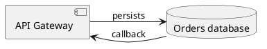

# Architex interchange formats

Choose **Model** in either dialog: **Metamodel** or **Instance model**. The selector initially matches the active graph tab and switching it changes the graph view. Every new export has a `modelType` discriminator (`metamodel` or `instances`) in its structured payload.

- Metamodel exports contain components, ports, default parameters, and dependencies; instance collections are empty.
- Instance exports contain instances, parameter overrides, and port connections; component/dependency collections are empty. Load the matching metamodel before importing instances.
- Instance import replaces only the instance collections. Metamodel import replaces only definitions and retains compatible instances. A failed compatibility check changes nothing; explicitly select **Clear existing instance model** if replacement should discard instances.
- Wrong-model files are rejected. Legacy workspace files without a discriminator are inferred from their collections; instance import never overwrites definitions from a legacy bundle. Empty legacy files default to metamodel; tag an empty instance file explicitly.

Ctrl/Command Z restores a successful import. File imports are limited to 10 MB. JavaScript rule libraries and enabled settings are local configuration and are never modified by model import.

## Excel (`.xlsx`)

The workbook contains these worksheets, with a frozen header row and filters:

| Sheet | Columns |
| --- | --- |
| Workspace | version, name, modelType, portModelVersion |
| Components | id, name, category, description, parentId, x, y |
| Ports | componentId, id, name, description, allowedComponentIds |
| DataPorts | instanceId, id, name, description, definitionId |
| ComponentParameters | componentId, key, value |
| Dependencies | id, source, target, label |
| Instances | id, componentId, name, x, y |
| InstanceParameters | instanceId, key, value |
| Connections | id, sourceInstanceId, sourcePortId, targetInstanceId, targetPortId |

All nine sheets and their exact header order are required, even when empty. The Workspace sheet has one data row (version `1` and modelType `metamodel` or `instances`). Legacy two-/three-column Workspace headers and four-column policy-port tables are migrated. New version-2 workbooks require DataPorts. allowedComponentIds is a JSON array of component IDs in its cell. Add/edit/remove rows in Excel to change the model. Use stable IDs to join rows across sheets; changing an ID requires updating references. Component/instance parameters are separate string key/value rows, not JSON blobs. Keep numeric coordinates and IDs as plain values; formulas, rich cells, dates, duplicate parameter keys, and unknown references are rejected. String values beginning with `=` are written as text, not Excel formulas. Parent containment must be acyclic; dependencies and port connections may contain cycles.

The XLSX exporter/importer uses ExcelJS locally in the browser. It never evaluates formulas or runs macros; `.xls` and `.xlsm` are not accepted. Plain workbooks unrelated to the listed schema require conversion to the worksheet structure above.

## Sphinx-Needs (`.needs.json` or native `needs.json`)

Exports use the native `project`, `current_version`, `versions[version].needs` and `needs_amount` structure. Each component (metamodel export) or instance (instance-model export) becomes a `req` need with a title, content, tags, and directed `links`. Need IDs (`AX_C_0001`, `AX_I_0001`, etc.) are valid Sphinx-Needs identifiers; a top-level `architex` metadata section maps them to original IDs and preserves ports, parameters, subgroups, layout, dependency labels, and connections.

Use the exported file in a Sphinx project:

```python
# conf.py
extensions = ['sphinx_needs']
```

```rst
Architecture
============

.. needimport:: architex-instances.needs.json
   :version: 1.0

.. needtable::
   :columns: id;title;links
```

Verified against Sphinx-Needs 9.0.0 and Sphinx 9.1.0 with `sphinx-build -b html -W` (warnings treated as errors).

Re-importing an Architex needs export restores the embedded structural model and applies edited need titles/content and component links. Removing an instance link removes its associated port connections. Adding an instance link without defined ports is rejected: edit the embedded model, Excel connection sheet, or Architex graph to specify port endpoints. To add/remove complete components or instances, use the embedded model or XLSX, rather than altering only the native needs list.

Native Sphinx-Needs JSON without Architex metadata imports each need as a generic component and each outgoing `links` entry as a dependency, including cycles. The selected version is `current_version`, or the last version when unspecified. Alternate custom link fields, need parts, statuses, and tags are not mapped to architecture semantics. Missing link targets are reported. A native Sphinx re-export may strip the top-level Architex metadata; such files import as generic metamodels and cannot restore instance ports or parameter definitions.

## PlantUML (`.puml`, `.plantuml`)

Export creates a normal `@startuml` component diagram with directed arrows. A comment line (`' architex-json: ...`) embeds the complete model to preserve ports, parameters, subgroup relationships, IDs and coordinates. PlantUML rendering is performed with external PlantUML tools; Architex does not contact a rendering server or execute PlantUML code.



Supported native declarations: `component`, `rectangle`, `database`, `queue`, `node`, and `interface`, with quoted names and aliases, bare identifiers, or bracket names. Supported arrows: `-->`, `->`, `..>`, `<--`, `<-`, and `-up->` / `-down->` / `-left->` / `-right->`. Bracket endpoints such as `[Web] --> [Database]` create implicit components. Relationship labels follow `:`. All native declarations become generic metamodel components. This is a component-diagram subset, not a general PlantUML language parser: sequence diagrams, macros, includes, package blocks, sprites, and arbitrary directives are rejected rather than executed or silently ignored.

For Architex exports, changing names or metamodel arrow labels/endpoints updates the re-imported model; keep exported aliases stable. Instance arrows use `sourcePort → targetPort` labels so endpoint changes can be validated. Keep instance edge order and count stable; add/remove instance connections or components in the embedded JSON, workbook, or Architex graph. Native PlantUML without the Architex payload imports the supported diagram as a new metamodel.

JSON/YAML use `workspace.schema.json` directly. Earlier SVG, draw.io, and Markdown behavior is described in README.md.

## Complete Sphinx-Needs RST projects

### Folder and ZIP import

Use the recursive folder picker in **Import** or select a ZIP. The selected directory is the project root; paths inside it remain relative and keep their hierarchy. All selected source files and assets are retained. `_build`, `.git`, `.venv`, `__pycache__`, and `node_modules` directories are excluded. ZIP archives with a single enclosing directory have that wrapper stripped. An individual `.rst` file is also supported, but external references require selecting the complete folder.

Static import reads explicit need directives with `:id:` options, including configured custom need directive names, `:links:`, continuation lines, descriptions, and nested needs. IDs must be unique across files; forward and cyclic links are resolved after reading the project. Existing relative `include` and `literalinclude` paths must resolve within the selected root. Code/literal examples are skipped. Toctrees, prose, comments, config files, and assets are retained as source; the app does not run Sphinx, Python configuration, directives, conditions, substitutions, macros, templates, or dynamic need generation. Needs without explicit IDs and references to undeclared need parts are reported rather than invented. A build may still need the original project's extensions and configuration.

Metamodel import creates a component for each selected need and dependencies for its `links`; nested needs become subgroups. Architex node comments/manifest preserve editable ports, parameter defaults, IDs, positions, and dependency labels.

Instance import uses the **active metamodel**. A native instance need identifies its component using a tag:

```rst
.. req:: Primary orders database
   :id: PROD_DATABASE
   :tags: architex-instance, component:database

   The production database.
```

The `database` ID must exist in the active metamodel. Native links become connections only when both instance records have exactly one explicit data point. Component policies are never used as data points. Untyped native instance needs start with an empty data-point array. Links lacking unambiguous data points require Architex connection metadata; otherwise the app reports the ambiguity without changing the workspace. Import without ambiguous `:links:` and connect the ports graphically if no metadata is available. `architex-component` and `architex-instance` tags distinguish scopes in native projects; untagged needs belong to the selected import scope. Custom `:component:` or `:architex-component:` options are also recognized, but require corresponding Sphinx configuration if used outside Architex.

Imports are bounded to 1,000 retained files, 10 MB per file, and 50 MB of total uncompressed contents. Absolute paths, ZIP traversal, duplicate paths/need IDs, missing includes, and unresolved links are rejected. Binary files use base64 in retained workspace source metadata; browser localStorage may be too small for large projects, so use exported files to retain an external copy.

### RST project export

Choose **Sphinx-Needs — complete RST project (.zip)**. ZIP contents include:

- Existing RST files at their original paths, with edited need blocks updated in place and surrounding prose retained.
- Nested source folders, includes, configuration and binary assets.
- Native `req` directives for new nodes under `architex/metamodel/` or `architex/instances/`, plus toctree entries.
- `conf.py` and `index.rst` when the project did not already supply them.
- A root `architex-model.json` manifest and ordinary RST `architex-node` comments for exact graph/port/parameter reconstruction. Neither executes code.

Re-importing the project applies native title/content/link edits and the selected model type, while retaining source paths. New instance links with ambiguous ports require explicit connection metadata. Deleted graph nodes remove their bound need blocks; added nodes get new documents. Repeated export does not duplicate source files. Empty directories are not represented by browser folder selection; all retained file paths are preserved.

To build an exported project after extraction:

```sh
python -m sphinx -b html -W . _build/html
```

Generated metamodel and instance projects were each verified with Sphinx-Needs 9.0.0 / Sphinx 9.1.0 and warnings treated as errors. Native projects retain their own `conf.py`; install any extensions that project requires.

Retained source lives in the optional `sphinx.metamodel` / `sphinx.instances` workspace fields described in the downloadable JSON Schema. RST/ZIP and structured formats with an embedded model carry it; XLSX carries graph tables and does not embed arbitrary source project assets. Use RST ZIP for full source-folder exchange.

### Programmatic scoped imports

```js
const incoming = await ArchitexIO.parseImportFile(file, 'instances');
ArchitexIO.applyImportedModel(incoming, 'instances');
// Explicitly replace definitions and discard existing instances:
ArchitexIO.applyImportedModel(metamodelFile, 'metamodel', { clearInstances: true });
```

`ArchitexScope.exportModel(workspace, 'metamodel' | 'instances')` returns a scoped JSON object. `ArchitexIO.exportFile(format)` exports the active graph type. RST folder/ZIP parsing never executes source files; need declarations are read from `.rst` documents. Non-RST snippets and assets are retained, but dynamically generated needs and declarations inside included non-RST snippets are not interpreted.

All new model payloads use `portModelVersion: 2`. Component `ports` contain `allowedComponentIds` policies; instance `ports` contain data points with `definitionId`. Structured and embedded-model formats preserve both collections. Legacy version-1 files are migrated at the import boundary before validation. Policy violations in existing links are reported; missing definitions or endpoint IDs are rejected.

Component `color` is a six-digit hex string, with a free-text `category`. Both policy ports and data points include `direction` (`in` or `out`). XLSX adds `color` to Components and `direction` to Ports and DataPorts. Older column sets are accepted and migrated: missing colors use a neutral default, directions follow existing connection endpoints (source output, target input), and otherwise default to the policy direction or input. Draw.io port geometry places inputs on the left and outputs on the right.

Components can include an optional `icon` containing an embedded PNG data URL (maximum 32,767 characters). Icon uploads are rasterized to thumbnails so icons fit Excel cell limits. The Components worksheet includes an `icon` column; older header sets remain importable. Icons are retained in embedded model payloads and drawn in SVG and draw.io exports.
