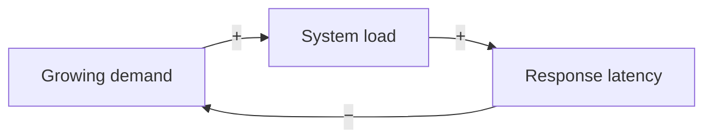
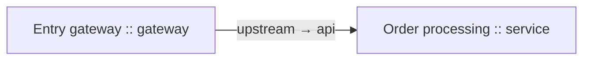

# architeX

A browser-based architecture editor with separate **metamodel** and **instance** graphs. Runs offline; js-yaml 4.1.1 is vendored under its MIT license. No build required.

## How to get started

### 1. Start Architex and the relay

Install Python 3, open a terminal in the repository root (the directory containing `architex/`), and run:

```sh
python3 server/server.py
```

Keep the terminal running. No build, npm install, or Python packages are required.

- Open `http://localhost:8000/architex/` for the architecture editor.
- Open `http://localhost:8000/relay` for the relay's separate provider configuration UI.

Graph editing works without an AI account. Chat requires a configured provider on the relay. A plain static server or GitHub Pages can host the editor, but cannot run the Python relay.

If port 8000 is occupied, use `python3 server/server.py --port 8001` and replace port 8000 with 8001 in the URLs below.

### 2. Configure an AI provider on the relay

1. Open the relay UI at `/relay`.
2. Select a provider profile, or choose **New provider → Add example profile**. Examples cover Eden AI, OpenAI, Gemini, LiteLLM and OpenRouter.
3. Enter the provider endpoint, a model available to your account, and the API key. For Eden AI, the example endpoint is `https://api.edenai.run/v3/llm/chat/completions` and the example model is `openai/gpt-4o-mini`.
4. Click **Save & activate**, then **Test active provider**. A successful test confirms the saved configuration can contact the provider.

Provider settings and keys are stored on the relay server, by default in `~/.config/architex-relay/providers.json` (or under `XDG_CONFIG_HOME`). Choose another file with `--config /path/to/providers.json`. Saved keys are hidden in the UI; leave the key field blank to retain an existing key. Configuration imports and exports are also in the relay UI; exports omit keys unless **Include API keys** is selected.

### 3. Connect Architex to the relay

1. On the desktop, click **AI relay**. In AI chat, **Relay** also opens the connection settings.
2. Set **Relay server URL** to `http://localhost:8000` (the origin only, without `/relay` or `/api/chat`).
3. Click **Save relay URL**, then **Test relay**.
4. Use **Open provider settings** whenever you need to change providers or keys.

Architex configures only this relay URL. It sends conversation messages to the relay; the relay selects the active provider and handles authentication. **Test relay** checks the connection to the relay. **Test active provider** in the relay UI checks the upstream AI service.

Legacy browser provider settings are not used by the shared chat. Provider configuration is managed in the relay UI.

### 4. Build and connect your architecture

1. Open **Metamodel**, add building blocks, and edit their names, categories, colors and parameter defaults in the inspector. Use **Subgroup of** to place a component under another.
2. Add metamodel ports as connection policies. Set their **Direction** and **Allowed instance component types**. Both endpoint policies must permit the peer's type; an empty selection allows no connections.
3. To add a metamodel dependency, enable **Connect** and click its source component, then its target.
4. Select a component and click **Create instance**. In the **Instances** tab, edit the instance's independent data-point ports, their names, directions, policy references and parameters. Clicking a library component in this tab creates another instance.
5. Enable **Connect** and click an output port and an input port. Either click order works; the connection is stored output → input. Inputs appear on the left, outputs on the right. Selections clear after connection; Escape cancels.
6. Use **Clean up** to arrange the diagram. Metamodel dependencies flow left to right, with subgroups beneath their parent. Drag blocks, pan the background, scroll to zoom, or use Fit.
7. Read **Validation** for incomplete or invalid connections. **Rules** lets you enable checks or load examples for equal port names and red unconnected-port highlights.

The sample workspace is ready to explore. To try a simple new connection, create two component types, give the sender an output policy and the receiver an input policy, allow each type in the other's policy, instantiate both, and connect their data points. If the same-name rule is enabled, give the two data points identical names.

### 5. Ask the AI to adapt the models

Open **AI chat** and ask a question or describe an edit, for example:

> Add an audit-service component and one production instance. Connect an audit input to the existing order-event output. Preserve existing IDs, parameters and connections.

With document context enabled, requests include both models, validation rules, the schema catalogue and the spec-driven handover template. **Attach files** adds uniquely named reference documents. The relay must be running while you chat.

For an edit, use **Review proposed changes** to inspect the specification and differences, then **Apply reviewed changes**. Nothing changes merely because a response arrives. Model references, connection policies and enabled rules are checked before applying; Undo restores the combined model/rule change. Newly generated rule code starts disabled.

Below the input, **Agent call output** shows the raw response. Use **Download request** to inspect the model handover.

### 6. Save and exchange your work

To start with an empty workspace, use **Clear models** in the top header and confirm. This removes all component definitions, instances, dependencies, connections and retained Sphinx project sources. **Ctrl/Command Z** restores them in one step. Validation rules and the relay connection are preserved. If the header is folded, reopen it with **Show header**.

Browser storage remembers the workspace locally. Use **Export** for a portable copy: export the **Metamodel**, then the **Instance model**. Import them in the same order so instance references can resolve. Rules are exchanged independently through **Rules → Export library / Import library**. Provider configuration is exchanged only in the relay UI.

Use the header arrows to fold panels; drag their dividers to resize them. **Hide header / Show header** folds everything above the model tabs, and **Hide graph** folds the diagram. These layout preferences are remembered locally.

### When something does not work

| Symptom | What to do |
| --- | --- |
| Relay unavailable or “Failed to fetch” | Keep `server.py` running, verify the relay origin and port, then use **Test relay**. A static web host alone has no relay. |
| Provider authentication, model or quota error | Open `/relay`, correct the active profile, **Save & activate**, and **Test active provider**. |
| CORS when the editor is hosted separately | In the relay UI, save the editor's exact origin under **Allowed Architex origins**. Architex's relay settings show the origin to use. |
| Request says protocol version 2 is required | Restart the relay using the current `server/server.py`. |
| Missing template/schema files | Serve the whole repository; preserve `llm-handover.md`, `schemas/` and the app scripts together. Open the served app rather than a `file://` URL for chat. |
| A new connection is rejected | Check output/input directions, both component-type allowlists, and enabled validation rules. |

For example, when the editor is on GitHub Pages, keep the relay on your machine and allow the Pages origin (no repository path):

```sh
python3 server/server.py --allow-origin https://bdug.github.io
```

Then configure `http://localhost:8000` as Architex's relay URL. If the browser asks for local-network access, allow it for the editor. The relay is intended for a local trusted user; keep its provider administration UI private. See [AI.md](AI.md) for storage, CORS and protocol details.

## Modeling

Components have stable IDs, editable names/categories/descriptions, nested subgroups (`parentId`), named/described ports, and string key/value parameter defaults. Dependencies form a directed graph; cycles and self dependencies are valid. Subgroup containment must remain a tree/forest. Instances reference a component, copy its defaults when created, and maintain independently editable parameter values. Component ports are connection policies with explicit `allowedComponentIds`; instances own separate data-point `ports` with their own names/descriptions and a `definitionId` referring to one policy. Both endpoint policies must allow the other instance’s component type. An empty allowlist allows no connections.

Use the library or **New building block** to select/add components. In the inspector, edit properties, ports, parameters, subgroup parents, or create instances. In the instance tab, clicking a library component creates another instance. Adding or renaming a component policy does not change existing instance data points. New instances start with an independently editable data point per current policy; add/remove/rename them in the instance inspector. A referenced policy cannot be deleted until its data points are reassigned or removed. Deleting an instance data point removes only its own connections; deleting components removes their instances and related links.

Drag nodes to position them. Drag empty canvas to pan, scroll to zoom, use fit/zoom buttons, or auto layout. **Connect** then click two components to add a dependency. In the instance view, enable **Connect**, then click an output and an input port to connect them. Connections are directed; ports have an explicit input/output direction and may have multiple links. Self connections between distinct ports and cyclic graphs are allowed. Click a link to edit its dependency label or delete it. Ctrl/Command Z undoes changes; Ctrl/Command Shift Z redoes; Escape cancels connection mode; F fits the graph.

Every instance port must participate in at least one connection. Missing connections are documented in the live Validation panel and downloadable timestamped JSON report. Click an issue to inspect the relevant node. Invalid references, duplicate IDs, and subgroup cycles are rejected on import; unconnected ports are retained as valid, incomplete work. Imported strings are displayed as text, never executed.

## Files and coding agents

**Import** and **Export** each have an explicit Model selector. Metamodel exchanges contain only component definitions, ports, defaults, and dependencies. Instance-model exchanges contain only instances, their parameter values, and port connections, referencing the active metamodel. Files carry a `modelType` discriminator; importing the wrong kind is rejected. Instance imports preserve the metamodel. Metamodel imports preserve compatible instances, or can explicitly clear them with **Clear existing instance model**. Imports validate atomically and support undo. To transfer a whole workspace, export/import the metamodel first and the instance model second. Browser localStorage saves the full working workspace.

Download the complete schema catalogue using **Agent schemas**, or use `workspace.schema.json` / `schemas/catalog.json`. It defines the same model used by JSON/YAML and embedded payloads. All IDs must be unique within each collection; policy IDs must be unique within their component and data-point IDs within their instance. All references must resolve. Parameter keys and values are strings. Arbitrary category names are supported. The schema enforces structure; the app additionally checks graph references, parent hierarchy, and port completeness.

- **JSON / YAML:** complete editable model, human and agent friendly. Standard YAML parsing uses the JSON schema (no executable tags).
- **draw.io:** native uncompressed XML with editable vertex, port, and edge cells, plus an `architex-data` payload. Open in diagrams.net, edit names/positions/port names and relationships, and export **uncompressed XML** to re-import those edits. Existing cells keep their IDs. New arbitrary draw.io cells in a metadata-bearing export are not component definitions; use JSON/YAML to add structure. For diagrams created outside Architex, uncompressed vertices and directed edges import as generic metamodel components/dependencies; containment becomes subgroup relationships. Compressed and multi-page files require exporting a single uncompressed page first.
- **SVG:** standalone vector diagram with complete JSON model inside `<metadata id="architex-model">`. Architex SVG files re-import losslessly through the standard Import path. Arbitrary SVG graphics and visual edits can be interpreted through **AI import**, with a semantic proposal reviewed before application. Edit embedded JSON or use draw.io for deterministic graphical interchange.
- **Markdown:** readable component, instance, dependency, connection, and validation documentation, plus an authoritative fenced `architex-json` model. Editing that block updates the re-imported model; prose alone does not.

Architecture editing and validation are local. Optional AI chat sends both current models and optional rule/file context to the configured relay; the relay owns all provider configuration and credentials. Exported files include parameter values; do not enter secrets. LocalStorage availability depends on browser settings. Initial sample architecture demonstrates cyclic dependencies and five fully connected instances.

## Validation

Run `node architex/test.js` from the repository root. Browser checks use the existing Playwright installation and system Chromium; see `architex/browser-test.cjs`. Serve the repository with `python3 server/server.py` before running browser checks.

## JavaScript validation library

Use **Validation → Rules** to manage custom JavaScript checks for both the metamodel and instances. The default rule requires a connection on every instance port; it is enabled by default and can be toggled independently. Model integrity checks always run. Scripts receive a read-only query/reporting API and execute in time-limited workers. Scripts save independently of imported models; imported JavaScript starts disabled. Findings appear live and in downloaded JSON reports. See [SCRIPTING.md](SCRIPTING.md) for the downloadable API reference, examples, execution limits, and browser/Node.js usage.

Scripting checks: `node architex/validation-test.cjs` and, with the static server running, `node architex/scripting-browser-test.cjs`.

## Excel, Sphinx-Needs, RST projects, and PlantUML

All formats are available in **Export** and **Import**, with separate metamodel and instance-model scopes. Instance exports reference component IDs from a separately loaded metamodel. Format details and examples are in [INTERCHANGE.md](INTERCHANGE.md).

**Excel XLSX** is a real editable workbook with nine relational worksheets (including separate ports and parameter rows). **Sphinx-Needs** uses native `needs.json` with component/instance needs and directed links. **PlantUML** exports native component diagrams with readable relationships and embedded model data. Native Sphinx-Needs and the supported native PlantUML component syntax import as metamodels.

**Clean up** arranges metamodel families by dependencies and subgroup hierarchy; instance graphs use ELK layered layout. It accounts for actual block heights, fixed port positions, cycles, and self connections, with separation between nodes. Connections use orthogonal visibility-grid routing around padded node obstacles, minimizing weighted distance and bends. Routing updates after moving blocks. Layout is undoable and persisted; fitting the view and SVG exports account for routed edges. Graph layout uses heuristics: crossing-free or globally optimal routing cannot be guaranteed for arbitrary non-planar graphs. If blocks are manually placed on top of one another, clean them up before expecting unobstructed routes.

Each validation rule now has its own immediate Enabled checkbox, including the built-in port-connection rule. Choices persist in local browser storage. Disabling a rule omits its findings from live validation, the scripting API, and JSON reports. Model schema and reference integrity checks remain mandatory.

Additional checks: `node architex/layout-test.cjs` and, with the server running, `node architex/exchange-layout-test.cjs`. Vendored runtime dependencies: js-yaml 4.1.1 (MIT), ExcelJS 4.4.0 (MIT), ELK.js 0.11.0 (EPL-2.0). License files are in `vendor/`; no installation or CDN access is needed at runtime.

## Complete Sphinx-Needs RST projects

Import a complete directory with the folder picker in **Import**, a `.zip` archive, or an individual `.rst` file. Recursive import resolves need IDs and links across files, recognizes nested needs as component subgroups, and retains original relative source paths, prose, configuration, and binary assets. Choose metamodel or instance model explicitly. Instance needs require a `component:<componentId>` tag or Architex metadata; graph connections require unambiguous ports.

Export **Sphinx-Needs — complete RST project (.zip)** to retain the folder tree and update edited need blocks in their original files. New nodes get RST documents and toctree entries. A generated project includes `conf.py`, `index.rst`, native need directives, and `architex-model.json` for exact IDs, ports, parameters, and connection endpoints. Both generated model types were tested with warning-free Sphinx-Needs builds. See [RST project details](INTERCHANGE.md#complete-sphinx-needs-rst-projects).

Tests: `node architex/rst-scope-test.cjs` and, with the static server running, `node architex/rst-browser-test.cjs`. JSZip 3.10.1 (MIT) is vendored for project ZIPs.

## AI architecture chat and relay configuration

Start the app with `python3 server/server.py` from the repository root. This serves the static app and adds a local, same-origin AI relay with no Python packages to install. The previous `python3 -m http.server 8000` command still supports graph editing but does not provide the AI relay.

The desktop’s **AI relay** settings contain only the relay URL. Configure providers, endpoints, models and API keys in the server’s separate `/relay` UI, then activate and test a provider there. Provider configuration has independent server-side JSON import/export and private persistence. **Architecture chat** supports reviewed edits of the metamodel, instance model and validation rules. New/changed generated scripts remain disabled until enabled in Rules; model/rule changes share Undo.

**Rules → Export library / Import library** exchanges the complete validation-rule library independently of models/providers. **Agent API (.txt)** downloads the offline coding-agent API description. Individual JavaScript rule files remain supported.

See [AI.md](AI.md) for provider endpoints, request routes, credentials, proposal behavior, configuration formats, and verification. Tests: `node architex/ai-test.cjs`, `python3 architex/server-test.py`, and (with the local server running) `node architex/shared-chat-browser-test.cjs`.

## Independent instance data points and loadable connection rules

Metamodel port policies select exact allowed component types; subgroup relationships do not automatically grant connectivity. Instance data points can be different in name/count from those policies, and multiple data points can reference one policy. Existing/imported connections that violate a changed policy are retained and reported for repair. New graphical connections enforce both endpoint policies. Legacy files without `portModelVersion: 2` are migrated once into independent data-point snapshots, preserving old endpoints and previously unrestricted connectivity. New files explicitly carry version 2 and require data-point definitions.

In **Rules**, choose **Same data-point names** or **Red unconnected ports**, click **Load example (disabled)**, then review and enable it. Standalone `.js` and importable JSON libraries are in `rules/`. The first uses exact, case-sensitive data-point name comparison and blocks new mismatched connections; imported/existing mismatches appear as findings. The second highlights unconnected data-point circles/labels red, including SVG exports. Disabling it removes those annotations. AI proposals also undergo enabled blocking-rule checks before application.

LLM chat uses the separately editable [llm-handover.md](llm-handover.md) spec-driven template and every schema in [schemas/catalog.json](schemas/catalog.json), including relay-connection/rule/proposal schemas and interchange contracts. Actual credentials remain excluded. Edits must contain an intent, requirements, acceptance criteria, implementation plan, validation plan and assumptions; these are explained in the response. Missing/stale schemas or a missing template prevent requests. Regenerate schema artifacts after source schema changes with `node architex/generate-schemas.cjs`.

Checks: `node architex/port-model-test.cjs` and `node architex/port-browser-test.cjs` (server running).

The **Metamodel description** button downloads the current configured component definitions, subgroup hierarchy, default parameters, dependencies, and connection policies together with their schema descriptions. This describes the configured metamodel separately from the generic **Agent schemas** catalogue.

To connect instance data points, enable **Connect**, then click the two port rows or dots in order. The first port is highlighted; clicking it again cancels the selection. A successful connection clears both selections and leaves Connect enabled for the next pair. Turning Connect off or pressing Escape cancels the selection. Outside Connect mode, clicking a port selects its building block for editing.

Architecture chat accepts uniquely named UTF-8 reference files through **Attach files**. See [AI.md](AI.md) for limits and how files are included in provider requests.

Component categories are free-text metamodel fields. Set **Component color** in the metamodel inspector to choose a six-digit hex color; instances inherit that color. Set each policy or data-point **Direction** to **Input · left** or **Output · right**. New instances copy their policy port directions, while existing data points keep their independent values. Connect an output and an input in either click order; the saved edge always runs from output to input. Connections between two inputs or two outputs are rejected. Existing invalid connections remain visible as validation findings for repair.

Older models without explicit colors receive a neutral default color and infer port directions from existing source/target connections; unconnected points use their policy direction, defaulting to input. JSON/YAML, Excel and embedded diagram/document exports retain colors and directions.

**Clean up** orders metamodel families from left to right along dependency arrows. Subgroup components are drawn inside their parent container, stacked below its own properties and ports. Containers expand to contain nested children. Dragging a parent moves the whole branch; dragging a child stores a relative position. Clean up resets these offsets. Dependencies of subgroup members contribute to the placement of the whole family. Cyclic families use consecutive columns and retain backward feedback connections; disconnected families are stacked without overlap. Instance cleanup continues to follow directed data-point connections.

Use **Hide graph / Show graph** in the graph toolbar to fold the visual section. Validation and the inspector remain available, and exports continue to work while folded. The same control applies to both metamodel and instance views.

The building-block library, inspector, and validation section can also be folded using their header arrows. Drag the divider at the library's right edge, the inspector's left edge, or validation's top edge to resize. Focus a divider and use arrow keys for keyboard resizing (Shift changes the step). On phones the inspector has a top divider for vertical resizing. Panel sizes and folded states are remembered locally and remain separate from model exports and undo history.

The introductory **Build a system. See the connections.** area has a **Hide introduction / Show introduction** control. Its folded state is remembered locally, and workspace action buttons remain available.

Use **Hide header / Show header** in the strip immediately above the Metamodel/Instances tabs to fold the entire area above the tabs, including workspace actions and the introduction. The tab bar and fold control remain visible for reopening. Its folded state is saved locally, independently of the introduction's own control.

Metamodel components display connection-policy labels without port circles. Interactive port circles are shown only on instance data points. Metamodel dependency links still connect whole components.

Categories are optional free-text labels. There are no built-in categories or category-specific icons/colors. New components start without a category; set each component’s color independently in the metamodel inspector.

**Agent schemas** and the rail's **Download schemas** button download the complete current catalogue directly from the bundled app, without a network fetch or relay. Downloads continue to work after the app has loaded, even if the network or relay is unavailable. **Metamodel description** uses the same bundle. Regenerating schemas with `node architex/generate-schemas.cjs` updates both the downloadable JSON files and `schema-bundle.js`; ship them together. AI handovers continue to load and validate the separately served catalogue.

In **Instances**, use **Subgroup** above the graph to show a component branch and its nested subgroups. **All subgroups** is selected by default. Paths identify nested components with similar names. Only instances in the selected branch and connections whose two endpoints are visible are drawn. The count shows visible versus total instances. Filtering does not modify the model: validation, AI context and all exports (including SVG) still use the full models. Clicking a validation issue outside the current branch returns to All subgroups to reveal it. Creating an instance outside the selected branch also returns to All subgroups.

To load a component icon, select a metamodel component and use **Component icon** in the inspector. PNG, JPEG, WebP and SVG files up to 512 KB are accepted and converted to an embedded PNG thumbnail (up to 96×96 pixels). The icon appears on component and instance cards, in the library and inspector. **Remove icon** restores the generic symbol; icon edits support Undo. Icons travel with metamodel exports, including an editable `icon` column in Excel.

For a dedicated Excel port list, select a metamodel component and click **Export ports (.xlsx)** in its inspector. To export ports from every component, use **Export → Model: Metamodel → All component ports (.xlsx)**. The report contains component/port IDs and names, subgroup paths, descriptions, input/output directions and allowed peer component IDs/names. A Components sheet includes components with zero ports. This is a standalone report; use the regular **Excel** model export for a workbook that can be imported back into Architex.

The Validation panel has **JSON** and **XLSX** report buttons. Excel reports contain Summary, Findings and Rules sheets, with timestamps, severity totals, model/port names and IDs, connection endpoints, rule activation states and script failures. Each export validates a snapshot of the full workspace and enabled rules, including instances hidden by a subgroup filter. A report with no findings still includes summary and rule information. Reports are separate from the editable model workbooks.


Double-click a component or instance to open its details dialog. It shows parameters, owned and exposed ports, subgroup descendants, related instances, dependencies, connections, validation findings, and complete related JSON. Close with the Close button or Escape.

Each metamodel port has an **Expose on parent** checkbox, enabled by default, including migrated files. Exposed subgroup ports become part of the parent interface and propagate through nested parents. Inherited policies use stable `exposed:<encoded-source-component-id>:<encoded-source-port-id>` IDs. New parent instances receive independent data points for this effective interface; existing instance data points remain unchanged and can be added individually. A referenced exposed policy cannot be hidden until its parent-instance data points are removed. Exposed policies retain their source policy permissions; reciprocal policies can permit the exposed source component type. Subgroup membership alone grants no connection permission. Excel model exports preserve owned definitions and exposure flags; dedicated port reports also list inherited policies.


Instance visualization also nests subgroup instances inside the unique visible instance of their immediate parent component type. Containers expand around their children, ports remain on the outer left/right sides, and dragging a parent moves its branch. **Clean up** arranges these instance families by their data-point connections. If the parent type has no visible instance or multiple instances, its subgroup instances remain separate because the metamodel does not specify instance ownership. Filtering to a subgroup shows its instances independently when the parent is hidden. This presentation does not change component membership or connection policies.


### Shared desktop AI chat

The floating **AI chat** button opens the same shared chat panel used by the other desktop apps. Configure the connection with **Relay**, or **AI relay** on the desktop. Requests include the metamodel, instance model, rule library, schema catalogue and the spec-driven instructions in `llm-handover.md`. Uncheck **Include current metamodel, instance model and validation rules** for questions without document context; edits require context.

**New conversation** excludes earlier messages from the next request. Attachments remain available. Replies and raw agent output appear in the panel. Proposed edits require review; omitted sections/fields retain their values and supplied arrays replace complete collections. schema/reference, connection-policy and active blocking-rule checks run before application. New or changed rule scripts remain disabled. **Undo AI edit** restores the prior models and rules if the workspace has not changed since applying the edit.

Architex chat explicitly supplies modelSchemas.metamodel and modelSchemas.instanceModel for document sections. The editable proposal schema uses the same component, port, dependency, instance and connection definitions, allowing omitted unchanged fields. File-exchange wrapper schemas remain reference material. Normalized proposals are checked against both section schemas and combined model references before review/application. Model schemas are also included in the downloadable agent API.


### Mermaid cause-effect chains

Choose **Export → Model: Metamodel or Instance model → Mermaid — cause-effect chain (.mmd)**. Use **Import** with the corresponding model selection to load a `.mmd` or `.mermaid` file. A single Mermaid fenced block is also accepted inside those files or a Markdown (.md/.markdown) document; surrounding prose is ignored. Multiple Mermaid blocks are rejected to avoid choosing the wrong diagram. Arrows retain Architex's stored source → target direction; effect labels such as `+` and `−` are text, not a causal inference calculation.

Exports use `flowchart LR` with readable nodes/arrows and a `%% architex-mermaid:` JSON comment. Keep that comment for exact preservation of stable IDs, ports, parameters, categories/colors/icons, subgroup membership and geometry. Visible node renames and supported edge edits are imported alongside the retained metadata. Metamodel and instance exports remain separate; instance imports require the matching active metamodel. Keep port-pair labels on exported instance connections.

Native files support `flowchart`/`graph` with LR/RL/TB/TD/BT directions, common bracket shapes (including stadiums, circles, cylinders and double rectangles), compact chains such as `A-->B`, labeled arrows such as `A -- effect --> B`, pipe labels, `<--`/`<-->`, and fan-out such as `A & B --> C & D`. Cycles, numeric/Unicode IDs, whole-line/inline comments and line breaks/entities in labels are accepted. Native positioning follows the diagram direction; cleanup can refine it.

Nested `subgraph` containers become metamodel components with child subgroup membership. Instance subgraphs are flattened because instance containment derives from the active metamodel; links must target actual instances, not subgraph containers. Hexadecimal node colors in `style`, `classDef`, `class` and inline `:::class` assignments are retained. Other styling, configuration directives and subgraph directions are normalized without being executed, with notes under **Import notes**. Front-matter titles name the imported model.

Other Mermaid diagram types, click handlers, undirected edges and the newer `@{shape: ...}` objects remain unsupported. Invalid statements produce line-specific errors and leave the current models unchanged.

Native metamodel examples: [cause-effect.mmd](examples/cause-effect.mmd) and [grouped Markdown diagram](examples/cause-effect-grouped.md).



For a native instance diagram, label new nodes as `Name :: component-id` (a unique component name also works). Definitions must exist in the active metamodel. New data points are created from each component's effective port definitions. An untyped node must unambiguously identify an existing instance by ID or name. Labels identify `sourcePort → targetPort` by data-point ID or unique name; an unlabeled edge is accepted only if its output and input endpoints are unambiguous. A causal label without a port pair can also be accepted with unambiguous ports; the label itself is not stored on instance connections and an import note explains this. Exported IDs are URL-encoded in edge labels and decoded on import. Example for the built-in demo: [cause-effect-instances.mmd](examples/cause-effect-instances.mmd).



Imports validate references and ports before replacing either model. Existing compatibility findings remain visible in validation. Replacing a metamodel retains existing instances unless **Clear existing instance model** is explicitly selected. Changes can be undone.

Tests: `node architex/mermaid-test.cjs` and, with the suite on port 8000, `node architex/mermaid-browser-test.cjs`. They cover both scoped round trips, native chains and instances, cyclic links, escaping, file import/Undo and unsupported syntax.


### Import both models together

In **Import → Model**, select **Both models — complete workspace / generate from Mermaid**. This replaces the complete metamodel and instance model in one validated operation; Undo restores both together. The selection is import-only; exports retain their existing separate scopes. Load a complete workspace JSON/YAML/XLSX (without the scoped modelType marker), or a supported diagram that contains the complete workspace. RST projects remain separate by model scope.

For plain Mermaid nodes such as `Demand --> Load`, Both models creates a component definition and one instance per component, plus directional connection-policy ports and connected instance data points for every dependency. Cause/effect labels remain on the metamodel dependencies. Subgroups are retained. No existing type definitions are needed for this native mode.

In **Instance model** mode, a plain Mermaid chain such as Demand --> Load now imports directly even when its nodes have no existing component mapping. Architex generates a namespaced set of component types, policies and connected data points, retaining the existing metamodel and its dependencies. The selected instance model is replaced, and Undo restores the whole change. Re-importing the same diagram updates its generated types without duplicating them. Import notes explain the added definitions.

Explicit Name :: component-id mappings and Architex Mermaid metadata remain authoritative; unknown explicit types or invalid port references are reported rather than guessed. When mixing typed and untyped nodes, provide a mapping for each new instance. **Both models** remains the option for deliberately replacing the complete workspace, rather than retaining the active metamodel.

A metamodel Mermaid export can also be expanded into definitions and matching instances. Existing ports are retained, so review validation findings for imported ports not used by a dependency. In Both models mode, typed native Mermaid diagrams generate missing component definitions and directional ports from their Name :: component-id declarations and sourcePort → targetPort edge labels. Existing definitions are retained and compatible port allowlists are extended for the imported links. Instance-only Mermaid exports with embedded metadata still require the corresponding active metamodel definitions because they do not include a full definition schema. Instance-only import mode keeps explicit type and port mappings strict.

Tests: `node architex/both-import-browser-test.cjs`, `node architex/mermaid-test.cjs`, and `node architex/rst-scope-test.cjs`.


Scoped imports now detect the model scope from the file rather than requiring a matching active tab. Instance-only JSON without modelType is recognized when it contains instances/connections and no component definitions. Mermaid files with Architex metadata use their declared scope before parsing. The model selector and active tab follow a successful import, and **Import notes** reports an automatic scope change. Instance imports retain the metamodel; metamodel imports retain compatible instances. Incompatible models remain rejected, and automatic scope detection never authorizes clearing retained instances. Untagged complete workspaces still require the explicit **Both models** selection.

Run `node architex/import-detection-browser-test.cjs` to verify scope detection, preservation of the other model, Undo and invalid-instance isolation.

The selected model scope is captured before reading an import file or RST folder, so changing the selector during loading cannot reinterpret the operation. Architex client assets carry a shared version tag to avoid combining cached legacy scope logic with a newer import dialog. Run `node architex/grouped-both-import-browser-test.cjs` for the exact grouped Markdown example in Both models mode, including Undo and asynchronous-scope regression checks.

Run `node architex/typed-both-import-browser-test.cjs` to reproduce the cause-effect-instances.mmd example with Both models selected against empty and partially defined workspaces, including generated ports, reciprocal connection policies and Undo.

## Workspace extensions

Open **Workspace** beside the virtual disk controls, or press **Ctrl+K / Cmd+K**, for searchable commands, content search and reviewed bulk replacement, named recovery points, portable workspace backups, three tool-specific AI workflow drafts, document validation/insights, and coding-agent handoff ZIPs. Restores preserve a recovery point first and reject stale or invalid changes. Files can move through either local or virtual disk.

See the [workspace tools guide](../shared-suite/WORKSPACE.md) for this app’s native backup behavior, raw source/formula search, inspection measurements and interoperability limits. Workflow drafts never send an AI request automatically.

## Tool-specific productivity actions

Open **Workspace → Tool actions** for reviewed editing helpers, JSON/Markdown/CSV inventories and a tool-specific AI review draft. Changes use native validation and save recovery before application. See the [action catalog and interchange guide](../shared-suite/WORKSPACE.md#tool-actions-and-portable-inventories) for this app’s operations and limits.

Additional **Workspace → Tool actions** capability: Fill unlabeled dependencies using their existing source and target component names. Review the native change preview before applying; a recovery point is saved automatically.

**Productivity extension:** Fill missing instance parameters from direct component defaults while preserving overrides and ports. Use **Workspace → Tool actions** to review and apply native changes.

**Reusable variants:** Duplicate the instance graph with fresh instance/connection IDs while reusing metamodel definitions and local port IDs. Available through **Workspace → Tool actions**, with native validation, preview and recovery.

## Draw architecture without a metamodel

Choose **Modeling mode → Direct diagram · no metamodel** above the graph tabs.
This opens a separate architecture diagram. Use **Add building block** to create
components, edit their names/descriptions/colors/parameters, and use **Connect**
to select a source component followed by its target. Connections may be cyclic.
Subgroups, dragging, zoom, cleanup, Undo, icons, and AI editing remain available.
Interface ports are descriptive; direct connections join components without
requiring type policies, instance creation or instance-port bindings.

The instance tab and type-policy controls are hidden. **Clear diagram** clears
only this diagram, with Undo. Switch back to **Metamodel and instances** to
restore that workspace. Both workspaces have separate saved content and in-memory
Undo histories; the mode selection persists across reloads. Keep external
backups: browser storage remains local to this origin/profile.

Import/export uses the existing component/dependency graph formats (JSON, YAML,
Mermaid, draw.io and other supported graph exporters). Internally, interchange
retains the established `components`/`dependencies` schema, also called the
metamodel section by existing consumers; in direct mode these are diagram nodes
and edges, with empty instance collections. No hidden type/instance pairs are
generated. Files containing typed instances are rejected in this mode; switch
back before importing them. The AI receives the selected modeling mode and is
instructed to edit the direct graph while keeping instance collections empty.
**Diagram description** downloads the configured nodes and connections.

Storage keys: `architex-modeling-style` selects the mode, `architex-direct-v1`
stores the direct diagram, and `architex-v1` continues to store typed models.

## Project ZIP

Use **Project ZIP** in the header, or **Workspace → Recovery → Import / export project ZIP**, to save and restore the complete native project. Choose Computer or Virtual disk. Imports validate and stage a review; applying preserves the previous project in Recovery. Embedded assets are included, while separate app/relay settings and external workspace files are excluded. See the [shared ZIP guide](../shared-suite/PROJECT-ZIP.md).

## AI source importer: sketches, graphics, PDF and code

Use **✧ AI import** in the top header for AI-assisted architecture extraction. The existing **Import** button continues to handle structured interchange formats directly. The importer is a separate workflow from the AI chat window, using the same relay, provider, chat protocol, spec-driven handover template and complete schema catalogue in the background. It does not consume your chat draft or add turns to the visible conversation.

1. **Select sources.** Load one file, several files, a folder or ZIP archives. The normal source chooser supports local disk and the shared virtual disk. ZIP folders and nested ZIPs retain their relative paths. Supported inputs include native PNG/JPEG/WebP/GIF images and PDFs; UTF-8 source code, SVG, draw.io, Mermaid, PlantUML, Markdown, JSON/YAML and other readable text. PPTX, DOCX, XLSX and VSDX packages can supply their XML and embedded media as sources; this is semantic interpretation, not lossless Office document import.
2. **Inspect the file list.** Each source has an inclusion checkbox, original-byte SHA-256 and source path. Text can be inspected; images have previews. Add reference notes and image detail where helpful. Unsupported, unreadable or unsafe-path archive entries appear explicitly in the excluded list. Compressed draw.io pages are expanded locally into readable XML, retaining all pages; the report identifies this preprocessing and keeps the hash of the original file. Imported SVG/XML/code is never executed or inserted as active markup.
3. **Choose semantic merge options before analysis.** First decide how to reconcile files and diagram views: unify semantically matching concepts, match only exact qualified names/IDs, or keep each source/view separate. Then select Both models, Metamodel only or Instance model only. Direct diagram mode uses components/dependencies and keeps typed instances empty. Choose one of:
   - **Merge semantically matching entities:** reuse matching stable IDs and retain unrelated entities, ports, parameters and relations. Keep existing nonempty attributes by default, or explicitly prefer incoming attributes. Ambiguous identities should remain separate or be raised as questions.
   - **Add distinct entities:** add new content while preserving existing entities and their attributes exactly.
   - **Replace selected scope:** permit removal within the chosen model scope; preserve other model sections and validation rules. Cross-model references must remain valid. Use Both models when replacing a metamodel would otherwise strand existing instances.
4. **Choose grouping and relationships.** Preserve explicit source groups, group by architectural responsibility, or keep new elements flat. Default relationships require explicit diagram/code evidence; inferred relationships are an opt-in and should be explained. Add import guidance, then check the confirmation checkbox. No provider request is made just by selecting files. Changing source selections or options requires confirmation again.
5. **Analyze and review.** The AI receives the selected sources, current architecture and authoritative metamodel/instance schemas. It proposes a model update and explains matches, assumptions and conflicts. Review added/updated/removed counts, affected existing entities and the complete proposed model. Questions can be answered using their options or the guidance field, followed by a new confirmed analysis. Invalid schema or merge-policy responses receive up to two repair requests with the same source references.
6. **Apply explicitly.** Nothing changes until **Apply reviewed import**. Schema, reference, selected-scope, merge-policy and existing validation-rule checks run before applying. A stale workspace or changed modeling style invalidates the proposal. Validation rules cannot be added, changed, enabled or disabled by this importer; existing enabled validators still run normally. Undo with Ctrl/Command+Z after closing the dialog.
7. **Keep an import report.** Download the interpretation, confirmed options, source paths/hashes, excluded files, actual proposal differences and application timestamp. Original upload bytes and provider credentials are not embedded in the report. **Stop** cancels analysis or prevents applying a pending result; closing the dialog also requests cancellation. Archive decoding stops cooperatively between asynchronous reads.

Use a provider/model that supports the selected native image/PDF formats; the importer links to the same AI provider menu. It does not silently replace unsupported PDFs/images with a guessed transcript. Source-only requests use the shared paging transport, with Continue/Retry controls inside the import dialog; native media remains native and follows the existing direct-transport behavior. No new file-count or upload-size cap is added; browser memory, provider context and file-format support still apply.

Semantic matches and inferred relationships are AI interpretations, not verified reconstructions. Review them against the originals. Tests use controlled AI responses with real browser workflows, ZIP decoding, mixed media, schema repair, scoped application, stale rejection, Undo and cancellation; no live-provider extraction accuracy is claimed.

### Importer navigation and large inputs

Sources and merge options are collapsible. Find sources by path/name, inspect previews only when needed, and use Previous/Next to browse 50 source rows at a time. This is a display page size, not an import limit: analysis includes every selected source across all pages and filters. Select/Deselect all applies to the entire source set. Filtering or changing pages does not change confirmation or selection. Advanced conflict/grouping/relationship settings are folded by default; the selected values remain summarized above confirmation.

Source bytes are read once for decoding and hashing; ZIP leaves are expanded as they are visited. Full proposal JSON, source previews and changed-entity details render only on expansion. Policy checks use ID indexes rather than repeated collection scans. Reproduce the local 8,000-component policy microbenchmark with `node architex/semantic-import-benchmark.cjs`; its timings exclude model/provider latency. Chat handovers retain every schema but reference the complete user-message payload instead of embedding the same model and attachments again in system text. Standalone handover exports still contain their supplied context.
