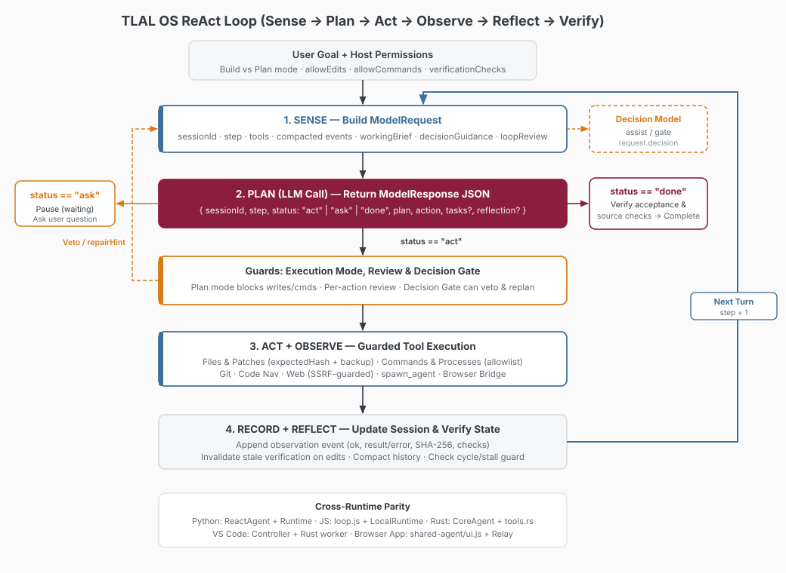
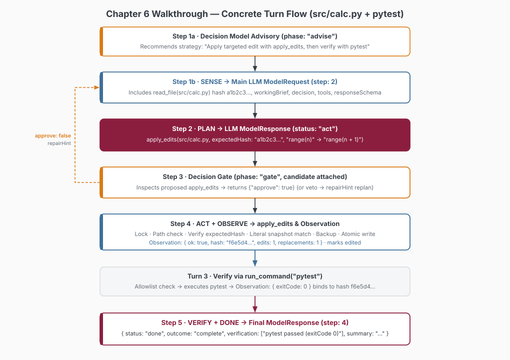

# How the ReAct Loop Works (`codingagentlib`, VS Code Extension & Browser App)

This document explains how the **Sense → Plan → Act → Observe → Reflect → Verify** ReAct loop operates across the Python SDK, JavaScript/TypeScript SDK, Native Rust SDK, VS Code extension (RabbitHole), and browser Coding Agent app, including how the LLM, decision model, and tools interact.

---

## 1. High-Level Execution Flow



---

## 2. Core Implementations by Runtime

| Layer | ReAct Loop | Runtime / Tool Execution | Decision Model (`off`/`assist`/`gate`) |
| --- | --- | --- | --- |
| **Python SDK** | [`ReactAgent`](file:///development/singlepageapps/codingagentlib/python/react.py) + [`Agent`](file:///development/singlepageapps/codingagentlib/python/agent.py) | [`Runtime`](file:///development/singlepageapps/codingagentlib/python/agent_runtime.py) | [`decision_model.py`](file:///development/singlepageapps/codingagentlib/python/decision_model.py) |
| **JavaScript SDK** | [`loop.js`](file:///development/singlepageapps/codingagentlib/javascript/loop.js) | [`LocalRuntime`](file:///development/singlepageapps/codingagentlib/javascript/local.js) (spawns Python worker) | Built into [`loop.js`](file:///development/singlepageapps/codingagentlib/javascript/loop.js) |
| **Native Rust SDK** | [`CoreAgent`](file:///development/singlepageapps/codingagentlib/rust/src/core.rs) + [`Agent`](file:///development/singlepageapps/codingagentlib/rust/src/runtime.rs) | [`tools.rs`](file:///development/singlepageapps/codingagentlib/rust/src/tools.rs) | [`decision.rs`](file:///development/singlepageapps/codingagentlib/rust/src/decision.rs) |
| **VS Code Extension** | [`Controller`](file:///development/singlepageapps/codingagentlib/vscode/src/controller.cjs) | Native Rust `codingagent-worker` via stdio | [`decision-model.cjs`](file:///development/singlepageapps/codingagentlib/vscode/src/decision-model.cjs) |
| **Browser Coding Agent** | [`shared-agent/ui.js`](file:///development/singlepageapps/shared-agent/ui.js) + `loop.js` | Python relay (`/api/agent/*`) + `projectBridge` | Configured via `#ag-decision-mode` in [`ui.js`](file:///development/singlepageapps/shared-agent/ui.js) |

---

## 3. How the LLM Participates

The runtime never gives the LLM direct OS or filesystem access; it communicates strictly through a JSON request/response contract ([protocol.json](file:///development/singlepageapps/codingagentlib/protocol.json)):

1. **Model Request (`ModelRequest`)**
   - Contains `sessionId`, `step`, `goal`, `permissions` (`allowEdits`, `allowCommands`, `applyProject`), `tools` (advertised JSON schemas), `events` (or compacted `events` + `compactedHistory` summary), `tasks`, and `responseSchema`.
   - **Context helpers** built deterministically before the LLM call:
     - `workingBrief` & `decisionGuidance` ([react.py](file:///development/singlepageapps/codingagentlib/python/react.py)): summarizes edited files, failed calls, and latest command results.
     - `loopWarning` / `loopReview`: detects repeated unchanged actions or consecutive failures.
     - `repairHint`: injected when the previous LLM reply failed JSON/schema validation or was vetoed by the decision gate.
     - `decision` (when `decision_mode` is `assist` or `gate`): advisory `strategy`, `focus`, `rationale`, and `risks` from the decision model.

2. **Model Response (`ModelResponse`)**
   - The LLM returns a single JSON object matching `responseSchema`:
     - `sessionId` and `step` must match the current reserved turn (prevents stale/replayed replies).
     - `plan`: concise public summary of the next step.
     - `status`:
       - `"act"` → `action: { tool, args, checks?, taskId? }` (or `actions: [...]` batch in `ReactAgent`, halting immediately on failure).
       - `"ask"` → `action: null`, `question: "..."` (pauses run in `waiting` state for user input).
       - `"done"` → `action: null`, `summary: "..."`, `outcome: "complete" | "partial" | "blocked"`, `verification?: [...]`.
   - Invalid JSON or mismatched IDs trigger bounded `repairHint` retries (up to 3 invalid responses before pausing).

3. **Multi-Model & Handoff Extensions**
   - **Decision Mode** (`auto` / `off` / `assist` / `gate`): Advises before the LLM call (`assist`/`gate`) and can veto proposed `"act"`/`"done"` responses before execution (`gate`).
   - **Model Handoff** (`handoff.py`, `handoff.js`, VS Code `handoffMode`): Optional one-time switch from a primary model to a continuation model when readiness is detected.
   - **Model Mosaic / Collaboration** (`mosaic.py`, `collaboration.js`, `ui.js`): Routes planning, coding, and review turns to separate profiles or runs solver/critic consultations.

---

## 4. How Tools Are Guarded and Executed

When the LLM proposes `status: "act"`, the runtime enforces multiple layers before executing any tool:

1. **Execution Mode (`build` vs `plan`)**
   - In **Plan mode** ([execution-mode.cjs](file:///development/singlepageapps/codingagentlib/vscode/src/execution-mode.cjs), `#ag-execution-mode` in [ui.js](file:///development/singlepageapps/shared-agent/ui.js)), `allowEdits` and `allowCommands` are forced `false`, and only read-only tools are advertised and permitted.
2. **Permission & Allowlist Checks**
   - **Read tools** (`read_file`, `find_files`, `grep_search`, `parallel_read`, `code_symbols`, `code_definition`, `code_references`, `code_diagnostics`, `read_image`, `git_status`, `git_diff`, `git_log`, `web_fetch`, `web_search`, `discover_tools`): allowed in both Build and Plan modes; paths are bounded to workspace root (no `..` or symlinks); `web_fetch`/`web_search` enforce HTTPS-only + SSRF private/loopback IP blocking.
   - **Edit tools** (`write_file`, `replace_text`, `apply_edits`, `apply_patch`, `delete_file`, `restore_file`): require `allowEdits: true`, optimistic concurrency via `expectedHash` (SHA-256 or `"missing"`), and record session recovery backups before mutating disk.
   - **Command tools** (`run_command`, `run_script`, `start_process`, `write_stdin`, `stop_process`): require `allowCommands: true`, an executable present in the configured command allowlist, literal `argv` (no shell interpolation unless an allowed shell is explicitly invoked), and optional per-action user review (`commandReview: "per-action"`).
   - **Sub-agent delegation** (`spawn_agent` in [react.py](file:///development/singlepageapps/codingagentlib/python/react.py)): spawns a bounded child `ReactAgent` (`maxSteps` 1–15, max recursion depth 2) with permissions capped at the parent session's permissions.
   - **Browser-bridge tools** (`read_current_project`, `apply_project` in [ui.js](file:///development/singlepageapps/shared-agent/ui.js)): inspect and update the live browser app document through its native validator and Undo stack.

---

## 5. Verification, Compaction, and Completion

- **Source-Bound Verification**: Any file edit invalidates prior command verification receipts; configured `verificationChecks` / `acceptanceRules` must pass against the **current** file hashes before `"done"` (`complete`) is accepted.
- **Context Compaction**: Older events are summarized/compacted when approaching character/event budgets, while full raw events remain recoverable via `read_history` and full command logs via `read_command_output`.
- **Audit & Packaging**: Every plan, tool call, observation, decision event, and command receipt is persisted in the session log and can be exported via `package_results` (ZIP).

---

## 6. Concrete Turn Payload Walkthrough



Below is a representative single-edit-and-verify cycle showing the exact JSON payloads exchanged between the runtime, optional decision model, LLM, and tool executor.

### Step 1a — Decision Model Advisory Request (`assist` / `gate`, before LLM)
```json
{
  "format": "codingagentlib/decision-request-v1",
  "sessionId": "8f3c2b1a9d4e7012c5f8a3b6d1e0492a",
  "step": 2,
  "goal": "Fix off-by-one bug in src/calc.py and run pytest",
  "availableTools": ["read_file", "apply_edits", "apply_patch", "run_command"],
  "phase": "advise"
}
```

**Decision Model Response:**
```json
{
  "approve": true,
  "stopRecommended": false,
  "strategy": "Apply a targeted edit with apply_edits using the SHA-256 from step 1, then verify with pytest.",
  "focus": "src/calc.py",
  "rationale": "File was already read in step 1.",
  "risks": []
}
```

### Step 1b — Main LLM `ModelRequest`
```json
{
  "protocol": "suite-coding-agent/v1",
  "sessionId": "8f3c2b1a9d4e7012c5f8a3b6d1e0492a",
  "step": 2,
  "goal": "Fix off-by-one bug in src/calc.py and run pytest",
  "permissions": {
    "allowEdits": true,
    "allowCommands": true,
    "applyProject": false
  },
  "workingBrief": {
    "editedFiles": [],
    "lastCommand": null
  },
  "decisionGuidance": "File contents observed; propose a targeted edit or verification step.",
  "decision": {
    "approve": true,
    "strategy": "Apply a targeted edit with apply_edits using the SHA-256 from step 1, then verify with pytest.",
    "focus": "src/calc.py"
  },
  "tools": [
    {
      "name": "apply_edits",
      "description": "Apply 1–32 exact edits to one existing UTF-8 file against its original snapshot.",
      "parameters": {
        "type": "object",
        "required": ["path", "expectedHash", "edits"],
        "properties": {
          "path": { "type": "string" },
          "expectedHash": { "type": "string" },
          "edits": { "type": "array" }
        }
      }
    }
  ],
  "events": [
    {
      "index": 0,
      "kind": "observation",
      "value": {
        "id": "8f3c2b1a9d4e7012c5f8a3b6d1e0492a_1",
        "tool": "read_file",
        "ok": true,
        "result": {
          "path": "src/calc.py",
          "hash": "a1b2c3d4e5f6...",
          "text": "def total(n):\n    return sum(range(n))\n"
        }
      }
    }
  ],
  "responseSchema": { "type": "object", "required": ["sessionId", "step", "status", "plan", "action"] }
}
```

### Step 2 — Main LLM `ModelResponse` (`status: "act"`)
```json
{
  "sessionId": "8f3c2b1a9d4e7012c5f8a3b6d1e0492a",
  "step": 2,
  "status": "act",
  "plan": "Include n in total(n) using range(n + 1).",
  "action": {
    "tool": "apply_edits",
    "args": {
      "path": "src/calc.py",
      "expectedHash": "a1b2c3d4e5f6...",
      "edits": [
        {
          "find": "return sum(range(n))",
          "replacement": "return sum(range(n + 1))"
        }
      ]
    }
  }
}
```

### Step 3 — Optional Decision Gate (`gate` mode, before tool execution)
```json
{
  "format": "codingagentlib/decision-request-v1",
  "sessionId": "8f3c2b1a9d4e7012c5f8a3b6d1e0492a",
  "step": 2,
  "goal": "Fix off-by-one bug in src/calc.py and run pytest",
  "phase": "gate",
  "candidate": {
    "status": "act",
    "plan": "Include n in total(n) using range(n + 1).",
    "action": {
      "tool": "apply_edits",
      "args": { "path": "src/calc.py", "expectedHash": "a1b2c3d4e5f6..." }
    }
  }
}
```
If the gate returns `{"approve": false, "rationale": "..."}`, the runtime skips tool execution and injects `repairHint` into the next `ModelRequest`:
```json
{
  "repairHint": {
    "step": 2,
    "source": "decision_model",
    "rationale": "Use a narrower anchor or verify expectedHash before editing.",
    "strategy": "Apply a single-line replacement in total(n)."
  }
}
```
If approved (`"approve": true`), the runtime executes `apply_edits`.

### Step 4 — Tool `Observation` Recorded by Runtime (`apply_edits`)
```json
{
  "index": 2,
  "kind": "observation",
  "value": {
    "id": "8f3c2b1a9d4e7012c5f8a3b6d1e0492a_2",
    "tool": "apply_edits",
    "ok": true,
    "result": {
      "path": "src/calc.py",
      "bytes": 42,
      "hash": "f6e5d4c3b2a1...",
      "edits": 1,
      "replacements": 1
    }
  }
}
```
Because `apply_edits` mutated `src/calc.py`, the runtime marks the workspace as edited and invalidates any earlier command verification receipts.

### Step 4b — Verification Turn (`step: 3`, `run_command`)
On the next turn, `workingBrief` lists `"src/calc.py"` as modified without post-edit verification, so the LLM proposes `run_command`:
```json
{
  "sessionId": "8f3c2b1a9d4e7012c5f8a3b6d1e0492a",
  "step": 3,
  "status": "act",
  "plan": "Run pytest to verify the updated total(n) implementation.",
  "action": {
    "tool": "run_command",
    "args": {
      "command": "pytest",
      "args": ["-q"],
      "cwd": ".",
      "timeout": 30000
    }
  }
}
```

**Verification `Observation` Recorded by Runtime:**
```json
{
  "index": 4,
  "kind": "observation",
  "value": {
    "id": "8f3c2b1a9d4e7012c5f8a3b6d1e0492a_3",
    "tool": "run_command",
    "ok": true,
    "result": {
      "jobId": "c9a1e7b204f3812d9e4a7c3b10293847",
      "command": "pytest",
      "resolvedExecutable": "/usr/bin/pytest",
      "exitCode": 0,
      "timedOut": false,
      "cancelled": false,
      "stdout": "1 passed in 0.04s\n",
      "stderr": "",
      "stdoutSha256": "9b74c9897bac770ffc029102a200c5de...",
      "stderrSha256": "e3b0c44298fc1c149afbf4c8996fb924..."
    }
  }
}
```
This binds the passing `pytest` receipt (`exitCode: 0`) to the post-edit hash `f6e5d4c3b2a1...` of `src/calc.py`.

### Step 5 — Final `ModelResponse` (`status: "done"`, after `run_command` verification)
```json
{
  "sessionId": "8f3c2b1a9d4e7012c5f8a3b6d1e0492a",
  "step": 4,
  "status": "done",
  "plan": "Report verified fix.",
  "action": null,
  "outcome": "complete",
  "verification": ["pytest passed (exitCode 0) after editing src/calc.py"],
  "summary": "Updated total(n) in src/calc.py to use range(n + 1) and verified with pytest."
}
```

---

## 7. How `"find"` → `"replacement"` (`apply_edits`) Is Performed

When the runtime executes the `apply_edits` action from Step 2 (`"find": "return sum(range(n))"` → `"replacement": "return sum(range(n + 1))"`), both Python ([agent_runtime.py](file:///development/singlepageapps/codingagentlib/python/agent_runtime.py#L658-L676), [agent_edits.py](file:///development/singlepageapps/codingagentlib/python/agent_edits.py)) and Rust ([tools.rs](file:///development/singlepageapps/codingagentlib/rust/src/tools.rs), [edits.rs](file:///development/singlepageapps/codingagentlib/rust/src/edits.rs)) perform the following steps in order:

1. **Permission & Path Boundary Check**
   - Verifies `allowEdits: true` on the session (and acquires `_file_edit_lock` in Python).
   - Resolves `"src/calc.py"` inside `workspace` root, rejecting `..`, absolute paths, symlinks, `.git`, and private state directories.
   - Rejects any extra top-level keys (such as `dryRun` or `preview`) — `apply_edits` only accepts `path`, `expectedHash`, and `edits`.

2. **Optimistic Concurrency Check (`expectedHash`)**
   - Reads `"src/calc.py"` (rejecting files over 2 MB or containing NUL bytes) and computes its current SHA-256.
   - Compares it to `args.expectedHash` (`"a1b2c3d4e5f6..."` from Step 1's `read_file`). If the file changed on disk since it was read, execution aborts with a revision conflict error without modifying disk.

3. **Literal Snapshot Matching & Overlap Validation** (`agent_edits.apply` / `edits::apply`)
   - Validates that `edits` has 1–32 entries, each containing only `find`, `replacement`, and optional `count` (1–1000, default `1`).
   - Searches the **original immutable snapshot** (never earlier replacement text) for literal occurrences of `"return sum(range(n))"` (no regex evaluation).
   - Confirms the exact number of occurrences equals `count` (`1` by default). If 0 or >1 matches exist, the whole batch is rejected.
   - Records the `(start, end)` span for every edit, sorts spans, and rejects any overlapping spans before assembling the updated text.
   - Checks that the resulting UTF-8 output stays within 2,000,000 bytes.

4. **Backup, Atomic Commit & Verification Invalidation**
   - Checks cancellation (`cancel.is_cancelled()`) and re-verifies `expectedHash` right before committing.
   - Saves the original file bytes and SHA-256 into the session's `backups/` directory (`backup`), enabling later rollback via `restore_file`.
   - Writes `"def total(n):\n    return sum(range(n + 1))\n"` atomically (temp file + sync + rename/replace).
   - Marks the workspace as edited (`edited`), invalidating any earlier command verification receipts, and returns `{ path, bytes, hash, edits: 1, replacements: 1 }`.
