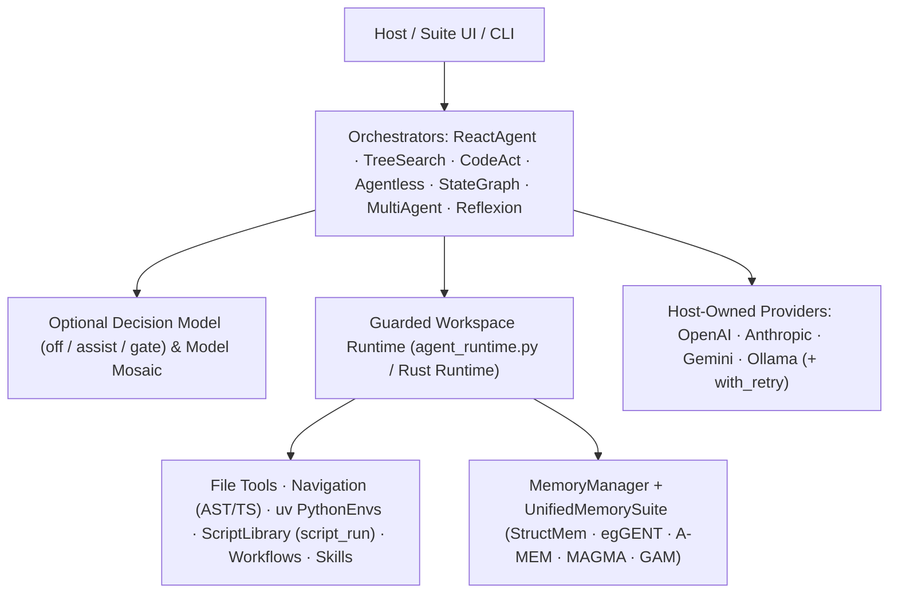

# Coding Agent & SDK Handbook

A complete, practical reference for building, extending, and operating the TLAL OS Coding Agent across **Python**, **JavaScript/TypeScript**, **Rust**, the **CLI**, and the **Browser Suite UI**.

---

## Architecture at a Glance



---

## 1. Python SDK

Install or import directly from the repository root (`from codingagentlib import ...`).

### 1.1 `ReactAgent` (ReAct + Context Compaction + Memory + Decision Model)
```python
from codingagentlib import ReactAgent
from codingagentlib.python.providers import openai_model, with_retry

model = with_retry(openai_model(
    endpoint="http://127.0.0.1:8000/v1/chat/completions",
    model_id="gpt-4o-mini",
    request=post_json,
))

with ReactAgent("/path/to/workspace", ["python3", "uv"]) as agent:
    result = agent.run(
        "Add unit tests for parser.py and verify they pass",
        model,
        allow_edits=True,
        allow_commands=True,
        remember_sessions=True,   # default True; set False to disable recall & persistence
        decision_mode="assist",   # optional: "off" | "assist" | "gate"
        max_steps=40,
    )
```

### 1.2 Beyond-ReAct Orchestrators

| Pattern | Python Class / Function | Best For |
| --- | --- | --- |
| **Tree Search (MCTS / LATS)** | `TreeSearchAgent` | Exploring competing patches with UCB1 + workspace snapshot backtracking |
| **Code-as-Action (CodeAct)** | `CodeActAgent` / `CodeActREPL` | Multi-step data/file manipulation in a persistent stateful Python REPL |
| **Agentless 3-Phase Pipeline** | `AgentlessPipeline` | Deterministic Localize → Multi-candidate Patch → Regression Test Selection |
| **Cyclical State Machine** | `StateGraph`, `END` | Explicit `code -> lint -> test -> code` workflows with conditional edges |
| **Planner–Executor Isolation** | `PlannerExecutorAgent` | Frontier planner builds a task DAG; isolated executors run each subtask |
| **Multi-Agent Collaboration** | `MultiAgentOrchestrator` | Read-only Searcher → isolated Coder → Tester → Reviewer merge gate |
| **Enforced Pre-Retry Reflexion** | `ReflexionLoop` | Forces verbal self-critique + immediate lesson capture after failures |

#### Spec-Driven Development (SDD) Runtime Gate
```python
from codingagentlib import Runtime

rt = Runtime("/path/to/workspace")
sid = rt.start({"goal": "Refactor auth", "allowEdits": True, "requireSpec": True})["id"]
# Edits raise PermissionError until an approved specification is recorded:
rt.dispatch({"op": "approve_spec", "session": sid, "spec": "1. Keep JWT API compatible. 2. Add expiry tests."})
```

### 1.3 `uv` Python Environments & `ScriptLibrary` (`script_run`)
- `PythonEnvironments` manages isolated `.venv` environments under `.suite-agent/pyenvs/<name>/`, preferring `uv` (`uv venv` / `uv pip`) and falling back to stdlib `venv` + `pip`.
- `script_run` runs managed, inline, or `libraryId` scripts with PEP 723 `# /// script` dependency bootstrap, `agent_io.load_input()`, `agent_io.emit()`, `AGENT_ARTIFACT_DIR`, and automatic credential/path-screened capture into `ScriptLibrary`.

### 1.4 Memory Management & 5 Memory Architectures
- **Session Persistence by Default**: `rememberSessions=True` recalls prior sessions (`agentMemory.previousSessions`), `MemoryManager` items, and `UnifiedMemorySuite` evidence on each `turn`, and captures episodes/lessons on `finish`. Pass `remember_sessions=False` (or `--no-remember-sessions` in CLI) to opt out.
- **`MemoryManager`**: 6 layered kinds (`fact`, `lesson`, `episode`, `preference`, `procedure`, `note`), importance + recency decay + usage scoring, near-duplicate merging, TTL expiry, `consolidate()`, and per-session `scratchpad`.
- **`UnifiedMemorySuite`**:
  - **StructMem** (`memory_struct`): Typed, schema-validated records (`entity`, `file_summary`, `api_contract`, `error_pattern`, `decision`, `config`, `dependency`).
  - **egGENT** (`memory_graph` `eggent_query`): Episodic `State -> Action -> Observation -> Outcome` trajectory graph.
  - **A-MEM** (`memory_graph` `amem_add` / `amem_search`): Zettelkasten atomic notes with bidirectional linking and dynamic neighbor evolution.
  - **MAGMA** (`memory_graph` `magma_add` / `magma_link` / `magma_query`): 4-view graph (`semantic`, `temporal`, `causal`, `entity`) with intent routing & Reciprocal Rank Fusion (RRF).
  - **GAM** (`memory_research`): Memorizer page store + iterative multi-hop Researcher synthesis.

### 1.5 Per-Session Skills
- `skill_save` with `scope="session"` stores overrides in `session['sessionSkills']` without mutating workspace-global `skills.sqlite3`. Use `skill_reset` to revert back to the workspace skill.

---

## 2. JavaScript / TypeScript SDK

```js
const {
  LocalRuntime,
  StateGraph,
  END,
  treeSearch,
  beyondReact,
  context,
  providers,
} = require('./codingagentlib/javascript');

// Multi-provider + retry
const model = providers.withRetry(
  providers.anthropicModel({ modelId: 'claude-sonnet-4-20250514', apiKey: process.env.ANTHROPIC_API_KEY })
);

// Conversation compression
const compacted = context.compressConversation(events, { keepRecent: 12 });
```

TypeScript definitions are provided in `core.d.ts`, `contracts.d.ts`, `graph-memory.d.ts`, `mosaic.d.ts`, and `providers.d.ts`.

---

## 3. Rust SDK

- **Portable Core (`--no-default-features`)**: `create_agent`, `CoreAgent`, `mosaic::ModelMosaic`, `graph_memory::ProjectGraphMemory`, `beyond_react::{StateGraph, END, tree_search, agentless_pipeline, reflexion_run, multi_agent_orchestrate}`.
- **Native Coding (`default` feature)**: `Agent::new(workspace, commands)` with guarded file tools, AST/navigation, verification binding, and `codingagent-worker`.

```sh
cargo test --locked --no-default-features --manifest-path codingagentlib/rust/Cargo.toml --test core --test beyond_react
```

---

## 4. CLI Reference

```sh
# Run ReAct loop (with optional decision model and session memory opt-out)
python3 -m codingagentlib.cli --workspace . react --goal "Fix tests" --allow-edits --allow-commands

# Manage uv / venv Python environments
python3 -m codingagentlib.cli --workspace . env create --name data
python3 -m codingagentlib.cli --workspace . env install --name data httpx pydantic

# Manage ScriptLibrary
python3 -m codingagentlib.cli --workspace . scripts list
python3 -m codingagentlib.cli --workspace . scripts run --id my-script --input '{"x": 1}'

# Manage MemoryManager & UnifiedMemorySuite
python3 -m codingagentlib.cli --workspace . memory stats
python3 -m codingagentlib.cli --workspace . memory research --query "auth token expiry"
```

---

## 5. Standalone SDK Packaging

Build independent Python and npm packages locally (no registry upload):

```sh
python3 codingagentlib/scripts/package_sdk.py --out /tmp/sdk-packages
```

Packages emitted: `codingagentcore`, `codingagentextensions`, `codingagentmemory`, `codingagenttools`, `codingagentproviders`, `codingagentstore`, `codingagentcoding`, `agent-core`, `agent-extensions`, `agent-memory`, `agent-store-node`, `agent-provider-openai`, `agent-coding`, and `agent-ui-bindings`.
