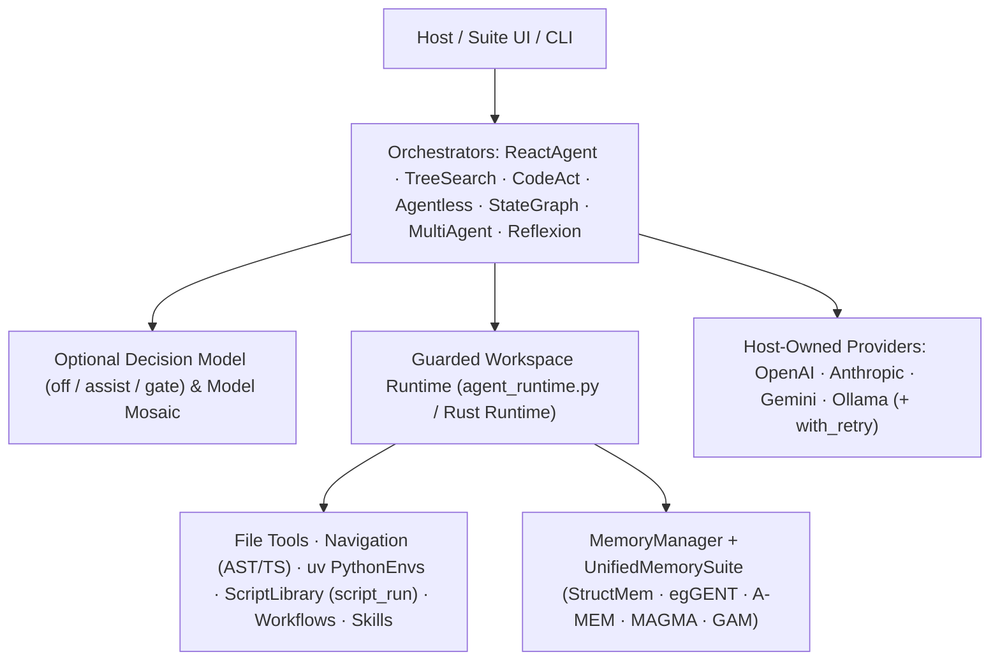

# Coding Agent & SDK Handbook

A complete, practical reference for building, extending, and operating the TLAL OS Coding Agent across **Python**, **JavaScript/TypeScript**, **Rust**, the **CLI**, and the **Browser Suite UI**.

---

## Architecture at a Glance



---

## 1. Python SDK

Install or import directly from the repository root (`from codingagentlib import ...`).

### 1.1 `ReactAgent` (ReAct + Context Compaction + Memory + Decision Model)
```python
from codingagentlib import ReactAgent
from codingagentlib.python.providers import openai_model, with_retry

model = with_retry(openai_model(
    endpoint="http://127.0.0.1:8000/v1/chat/completions",
    model_id="gpt-4o-mini",
    request=post_json,
))

with ReactAgent("/path/to/workspace", ["python3", "uv"]) as agent:
    result = agent.run(
        "Add unit tests for parser.py and verify they pass",
        model,
        allow_edits=True,
        allow_commands=True,
        remember_sessions=True,   # default True; set False to disable recall & persistence
        decision_mode="assist",   # optional: "off" | "assist" | "gate"
        max_steps=40,
    )
```

### 1.2 Beyond-ReAct Orchestrators

| Pattern | Python Class / Function | Best For |
| --- | --- | --- |
| **Tree Search (MCTS / LATS)** | `TreeSearchAgent` | Exploring competing patches with UCB1 + workspace snapshot backtracking |
| **Code-as-Action (CodeAct)** | `CodeActAgent` / `CodeActREPL` | Multi-step data/file manipulation in a persistent stateful Python REPL |
| **Agentless 3-Phase Pipeline** | `AgentlessPipeline` | Deterministic Localize → Multi-candidate Patch → Regression Test Selection |
| **Cyclical State Machine** | `StateGraph`, `END` | Explicit `code -> lint -> test -> code` workflows with conditional edges |
| **Planner–Executor Isolation** | `PlannerExecutorAgent` | Frontier planner builds a task DAG; isolated executors run each subtask |
| **Multi-Agent Collaboration** | `MultiAgentOrchestrator` | Read-only Searcher → isolated Coder → Tester → Reviewer merge gate |
| **Enforced Pre-Retry Reflexion** | `ReflexionLoop` | Forces verbal self-critique + immediate lesson capture after failures |

#### Spec-Driven Development (SDD) Runtime Gate
```python
from codingagentlib import Runtime

rt = Runtime("/path/to/workspace")
sid = rt.start({"goal": "Refactor auth", "allowEdits": True, "requireSpec": True})["id"]
# Edits raise PermissionError until an approved specification is recorded:
rt.dispatch({"op": "approve_spec", "session": sid, "spec": "1. Keep JWT API compatible. 2. Add expiry tests."})
```

### 1.3 `uv` Python Environments & `ScriptLibrary` (`script_run`)
- `PythonEnvironments` manages isolated `.venv` environments under `.suite-agent/pyenvs/<name>/`, preferring `uv` (`uv venv` / `uv pip`) and falling back to stdlib `venv` + `pip`.
- `script_run` runs managed, inline, or `libraryId` scripts with PEP 723 `# /// script` dependency bootstrap, `agent_io.load_input()`, `agent_io.emit()`, `AGENT_ARTIFACT_DIR`, and automatic credential/path-screened capture into `ScriptLibrary`.
- `script_run` is also supported as a `suite-tool-workflow/v1` / `v2` step in `agent_workflows`, and `providers.tool_schemas(TOOLS, provider=...)` automatically converts `Runtime` `arguments` maps into JSON Schema `parameters`.
- For Portable SDK v1 (`create_agent` / `CoreAgent`), use `runtime_tools(runtime, ...)`, `script_tools(runtime, ...)`, `program_tools(runtime, ...)`, or standalone `script_library_tools(script_library, pyenvs=...)`:

```python
from codingagentlib import Runtime, create_agent, script_tools, program_tools

with Runtime('/path/to/workspace', ['python3']) as rt:
    tools = script_tools(rt, allow_edits=True, allow_commands=True) + [
        t for t in program_tools(rt, allow_edits=True, allow_commands=True)
        if t['name'] in {'run_command', 'read_command_output'}
    ]
    agent = create_agent(model=my_model, tools=tools)
    res = agent.run('Generate and run helper script', allow_edits=True, allow_commands=True)
```

### 1.4 Memory Management & 5 Memory Architectures
- **Session Persistence by Default**: `rememberSessions=True` recalls prior sessions (`agentMemory.previousSessions`), `MemoryManager` items, and `UnifiedMemorySuite` evidence on each `turn`, and captures episodes/lessons on `finish`. Pass `remember_sessions=False` (or `--no-remember-sessions` in CLI) to opt out.
- **`MemoryManager`**: 6 layered kinds (`fact`, `lesson`, `episode`, `preference`, `procedure`, `note`), importance + recency decay + usage scoring, near-duplicate merging, TTL expiry, `consolidate()`, and per-session `scratchpad`.
- **`UnifiedMemorySuite`**:
  - **StructMem** (`memory_struct`): Typed, schema-validated records (`entity`, `file_summary`, `api_contract`, `error_pattern`, `decision`, `config`, `dependency`).
  - **egGENT** (`memory_graph` `eggent_query`): Episodic `State -> Action -> Observation -> Outcome` trajectory graph.
  - **A-MEM** (`memory_graph` `amem_add` / `amem_search`): Zettelkasten atomic notes with bidirectional linking and dynamic neighbor evolution.
  - **MAGMA** (`memory_graph` `magma_add` / `magma_link` / `magma_query`): 4-view graph (`semantic`, `temporal`, `causal`, `entity`) with intent routing & Reciprocal Rank Fusion (RRF).
  - **GAM** (`memory_research`): Memorizer page store + iterative multi-hop Researcher synthesis.

### 1.5 Per-Session Skills
- `skill_save` with `scope="session"` stores overrides in `session['sessionSkills']` without mutating workspace-global `skills.sqlite3`. Use `skill_reset` to revert back to the workspace skill.

---

## 2. JavaScript / TypeScript SDK

```js
const {
  LocalRuntime,
  StateGraph,
  END,
  treeSearch,
  beyondReact,
  context,
  providers,
} = require('./codingagentlib/javascript');

// Multi-provider + retry
const model = providers.withRetry(
  providers.anthropicModel({ modelId: 'claude-sonnet-4-20250514', apiKey: process.env.ANTHROPIC_API_KEY })
);

// Conversation compression
const compacted = context.compressConversation(events, { keepRecent: 12 });

// Expose generated scripts & programs to Portable SDK v1 (createAgent)
const { createAgent } = require('./codingagentlib/javascript');
const tools = [
  ...await runtime.scriptTools({ allowEdits: true, allowCommands: true }),
  ...(await runtime.programTools({ allowEdits: true, allowCommands: true })).filter(t => t.name === 'run_command'),
];
const core = createAgent({ model, tools });
await core.run('Run script and command', { allowEdits: true, allowCommands: true });
```

TypeScript definitions are provided in `core.d.ts`, `contracts.d.ts`, `graph-memory.d.ts`, `mosaic.d.ts`, and `providers.d.ts`.

---

## 3. Rust SDK

- **Portable Core (`--no-default-features`)**: `create_agent`, `CoreAgent`, `mosaic::ModelMosaic`, `graph_memory::ProjectGraphMemory`, `beyond_react::{StateGraph, END, tree_search, agentless_pipeline, reflexion_run, multi_agent_orchestrate}`.
- **Native Coding (`default` feature)**: `Agent::new(workspace, commands)` with guarded file tools, AST/navigation, verification binding, `delete_script`, `codingagent-worker`, and `core_tools` / `script_tools` / `program_tools` for `core::create_agent`.

```sh
cargo test --locked --no-default-features --manifest-path codingagentlib/rust/Cargo.toml --test core --test beyond_react
```

---

## 4. CLI Reference

```sh
# Run ReAct loop (with optional decision model and session memory opt-out)
python3 -m codingagentlib.cli --workspace . react --goal "Fix tests" --allow-edits --allow-commands

# Manage uv / venv Python environments
python3 -m codingagentlib.cli --workspace . env create --name data
python3 -m codingagentlib.cli --workspace . env install --name data httpx pydantic

# Manage ScriptLibrary
python3 -m codingagentlib.cli --workspace . scripts list
python3 -m codingagentlib.cli --workspace . scripts run --id my-script --input '{"x": 1}'

# Manage MemoryManager & UnifiedMemorySuite
python3 -m codingagentlib.cli --workspace . memory stats
python3 -m codingagentlib.cli --workspace . memory research --query "auth token expiry"
```

---

## 5. Standalone SDK Packaging

Build independent Python and npm packages locally (no registry upload):

```sh
python3 codingagentlib/scripts/package_sdk.py --out /tmp/sdk-packages
```

Packages emitted: `codingagentcore`, `codingagentextensions`, `codingagentmemory`, `codingagenttools`, `codingagentproviders`, `codingagentstore`, `codingagentcoding`, `agent-core`, `agent-extensions`, `agent-memory`, `agent-store-node`, `agent-provider-openai`, `agent-coding`, and `agent-ui-bindings`.

## 6. Extension pack: durable governed Python jobs

The [Extension Pack reference](../../codingagentlib/extension_pack/README.md)
describes an opt-in **Python generic SDK host adapter**. Import it from
`codingagentlib.extension_pack`, separately from `codingagentlib.python.extensions`
and the standalone `codingagentextensions` MCP/delegation package. It needs Python
3.10+, Git and POSIX file locks. Docker is optional; the existing JavaScript/Rust
SDKs do not gain this pack automatically.

Run the complete credential-free example from the repository root:

```sh
PYTHONPATH=. python3 codingagentlib/examples/extension_pack_demo.py
```

The example uses a real temporary Git repository and namespaced MCP read tool.
Its observable sequence is:

1. The host injects its model callback, public tools and extension configuration
   into `create_agent` using `pack.core_options`.
2. The callback requests `demo.inspect`; the existing SDK validates/dispatches it
   and stores its typed `tool_result` receipt. MCP tools require command permission
   even when the underlying callback only reads.
3. The model proposes completion. Missing current-source verification causes a
   persisted `verification_required` escalation; the next boundary returns
   `waiting` with a structured ask-for-help question.
4. The host runs a real `git diff --check` through the configured verifier, resolves
   the escalation and uses the SDK's ordinary `resume` method. Completion succeeds
   without repeating the earlier read.
5. Output includes the terminal result, retained checkpoint count,
   `auditChainValid` and the reserved token/micro-USD ledger. IDs/timings vary;
   this deterministic model makes no provider requests.

The demo configures only its named Git check. The production defaults additionally
require security and reviewer receipts; running the demo does not constitute SAST,
security review or browser verification of your application.

### 6.1 Configure the host before constructing an agent

`ExtensionPack(repository, state_directory, ...)` stores private job state outside
the source tree. `core_options` composes public policies, wraps registered callback
results for redaction, adds bounded conventions context and forwards redacted host
events. Configure `set_routing` first if token/cost limits are required: `Tier`
contains a host model callback, declared output ceiling and conservative per-token
prices in integer micro-USD. Bind that ceiling in the provider transport. Unknown
pricing/output bounds produce a warning rather than an invented monetary guarantee.

File configuration is data: tracked `.extension/policy.json` and
`.extension/verification.json`, repository `.agents/agents/*.md` /
`.extension/agents/*.md`, and `.agents/skills/*/SKILL.md` /
`.extension/skills/*/SKILL.md`. Explicit options take precedence. An explicit policy
object replaces the bundled policy; it does not merge omitted safety rules back
in. Persona definitions guide host-launched agents and do not launch agents.

### 6.2 Resume approvals, verification and checkpoint branches

| Waiting reason | Trusted host action | Resume behavior |
| --- | --- | --- |
| `approval_required` | Inspect `gateway.pending(session)` and call `approve_pending(session, actionSignature)` for the exact action | Approval is single-use; host edit/command permissions must still be granted |
| `verification_required` | Run every missing configured check with `verification.run`; then `resolve_escalation(session, resolution)` | Other sessions' receipts, failed checks and stale source digests remain rejected |
| `retry_threshold` / conflicting requirements | Resolve the cause, then record an operator resolution through `resolve_escalation` | A successful callback resets that operation's failure counter; changing exception text alone does not bypass the threshold |
| Budget exhaustion | Increase the reviewed routing ceilings, rebuild the configured host if needed, then use normal SDK resume | Reservations persist; checkpoint branches share the original job ledger |
| Uncertain host tool outcome | Reconcile actual effects through the SDK's pending-call API | Neither restart nor checkpoint branching blindly repeats the effect |

`store.checkpoints(tenant, session)` lists retained safe boundaries.
`store.fork(tenant, session, checkpoint_id)` returns a new resumable session;
it preserves earlier receipts and does not execute tools. It restores agent state,
not databases or arbitrary external side effects. Restore corresponding source
and artifact snapshots before replaying writes. Reopen the same private state
directory after a process restart; keep the same tenant identity.

### 6.3 Host responsibilities and optional capabilities

The host supplies real deterministic/security/browser/reviewer check callbacks,
OAuth/Bearer acquisition plus peer identity verification, and model streaming/auth.
`TrustedA2A` discovers live trusted Agent Cards and delegates through the existing
A2A client. `DomainMCP` prefixes names and filters server-side responses before
model context. A2A bridges remain separate from MCP tools.

For local agents the host supplies launch and lifecycle events. Feed
`subagent.started` to `subagent_lifecycle` and use its returned workspace for the
launch; forward merge/abort/recovery events for owned-tree cleanup. Save needed
temporary artifacts before abort/crash recovery. The adapter itself launches no
agents and creates no PRs.

`Sandbox` uses a reviewed digest-pinned Docker image, non-root UID, network none,
read-only source/root, resource limits and an in-container deadline. Code-action
results are data; host policy still governs writes. Missing optional capabilities
warn or leave verification unmet. `interactive=False` emits no UI payloads;
interactive sinks may receive AG-UI snapshots/deltas and A2UI review prompts.

Read the [requirement/evidence map](../../specs/EXT-IMPLEMENTATION.md) and
[observed status](../../specs/APPS-STATUS-REPORT.md) for qualification boundaries.
The ordinary SDK remains usable without this optional adapter.

## 7. Two-view UI and message trace

The [two-view example](../../codingagentlib/examples/two-views/README.md) shows the
lighter `EmbeddedAgent` integration independently of the extension pack.

| Selected SDK host | Launch from repository root | Additional requirement |
| --- | --- | --- |
| Python | `python3 codingagentlib/examples/two-views/serve.py python` | Python 3.10+ |
| JavaScript/TypeScript SDK | `python3 codingagentlib/examples/two-views/serve.py javascript` | Node 18+; sample is runnable CommonJS JavaScript |
| Native Rust | `python3 codingagentlib/examples/two-views/serve.py rust` | First run `cargo build --locked --manifest-path codingagentlib/rust/Cargo.toml --example two_views` |

Python serves the shared UI and optional provider bridge in every mode. The
selected language's SDK executes its tools. Run one host, then open
`http://127.0.0.1:8765`; use `--port` for another loopback port. Default commands
require no credentials or live model. Set `TWO_VIEWS_MODEL_URL`, `TWO_VIEWS_MODEL`
and optionally `TWO_VIEWS_API_KEY` in the host environment for a JSON-capable
OpenAI-compatible endpoint. Credentials stay out of the page.

### 7.1 Follow an actual edit round trip

Enter `svg_color purple`. The language callback receives an
`codingagentlib/embedded-v1` request with the current identity, step, document context, tool list
and earlier events. A representative response is:

```json
{"sessionId":"CURRENT_ID","step":1,"status":"act","plan":"Change the circle color","action":{"tool":"svg_color","args":{"value":"purple"}}}
```

`CURRENT_ID` and the step are placeholders here; a model must echo the actual
request identity. The SDK checks permissions and calls the registered host tool.
Its `observation` records the tool name, host call ID, success/error and resulting
document state. On the next model turn that observation is available to the
callback, which returns `done` and a summary. The UI then paints the circle.

`rich_text Welcome to the project` takes the same path through a different tool:
it replaces plain paragraph text in the styled document, retaining its heading.
The example does not import or execute arbitrary HTML/SVG. Invalid colors yield
failed observations and malformed demo commands yield a clarification question.

### 7.2 Display and export communication

The bottom panel retains user messages, complete model requests/responses,
public plans/step boundaries, observations and terminal results. **Export trace
JSON** downloads `two-views-trace/v1` with document `state` and all page `events`.
It includes document content. Each Send starts a fresh SDK session with current
view state; reloading the page clears that state and its in-page trace.

Events render after each bounded run returns; this sample does not stream model
tokens. The optional provider can perform two edits plus completion within its
three-step budget. The two-view `observation` protocol differs from the generic
extension-pack demo's typed `tool_result` protocol; do not interchange envelopes.

```sh
python3 codingagentlib/examples/two-views/verify.py
```

Build the Rust example first. This checks all language hosts through HTTP with
deterministic and mocked-provider callbacks. Real browser verification is a
separate optional container test in `codingagentlib.test_extension_pack`; a live
model endpoint needs its own transport/model verification.

## 8. Qualify an integration before rollout

Start with `node scripts/verify-suite.cjs` and the language-specific gates in
[AGENTS.md](../../AGENTS.md). The suite gate includes protocol and evaluation
fixture checks. The five [evaluation cases](../../evaluations/coding-agent/README.md)
include multi-file CSV aggregation and inspection beyond the first page of a large
JavaScript source file. Replay checks exercise actual tools with deterministic
model replies; run the explicitly opt-in live evaluator to measure a configured
model, keeping provider, fixture hash, budgets and repeated trials visible.

For RabbitHole, run `npm --prefix codingagentlib/vscode run verify`, then use
`VSCODE_EXECUTABLE=/absolute/path/to/code npm --prefix codingagentlib/vscode run test:editor-host`
with an installed Electron executable and a display on Linux. This separate check
uses real editor APIs and native execution in a disposable profile. It does not
bypass or automate user approval dialogs. File-page references such as
`@file:src/catalog.js#page=2` preserve the selected page; invalid pages report an
error. Text previews share a bounded budget, so retrieve omitted source with
native `read_file`/`read_files` tools instead of treating a preview as a full file.

For app hosts, run
`CHROMIUM_PATH=/path/to/chromium node scripts/verify-app-readiness.cjs --report /tmp/app-readiness.json`
with Playwright available through normal Node resolution or `NODE_PATH`. The
runner checks shared capability access across all 24 apps and selected native
review/recovery and import/export paths. Consult the
[current evidence](../../specs/APPS-STATUS-REPORT.md) for actual commands and
coverage; browser checks, editor-host checks, live model quality and external
protocol interoperability remain separate qualification steps.
