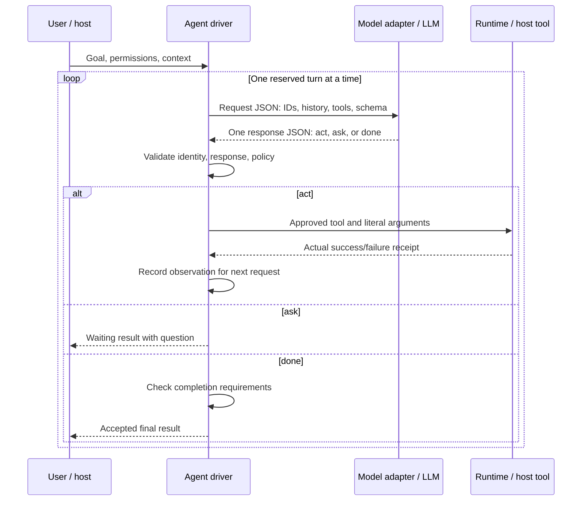

# Coding Agent How-to Book

A practical guide to running the suite coding agent, understanding every stage of
its LLM exchange, and embedding the agent through the SDK. Examples describe this
repository's implementation. No provider account is needed for the local examples.

## Contents

1. [Choose an interface](#1-choose-an-interface)
2. [Run a coding task in the suite](#2-run-a-coding-task-in-the-suite)
3. [Understand the complete round trip](#3-understand-the-complete-round-trip)
4. [Read the coding-agent request](#4-read-the-coding-agent-request)
5. [Return actions, questions and completion](#5-return-actions-questions-and-completion)
6. [Follow tool results back into the LLM](#6-follow-tool-results-back-into-the-llm)
7. [Use the Python coding API](#7-use-the-python-coding-api)
8. [Use the JavaScript coding API](#8-use-the-javascript-coding-api)
9. [Use the native Rust coding API](#9-use-the-native-rust-coding-api)
10. [Embed the portable SDK](#10-embed-the-portable-sdk)
11. [Connect a model transport](#11-connect-a-model-transport)
12. [Store, resume and recover](#12-store-resume-and-recover)
13. [Use the worker protocol](#13-use-the-worker-protocol)
14. [Troubleshoot and verify integrations](#14-troubleshoot-and-verify-integrations)
15. [Source and reference map](#15-source-and-reference-map)

Worked example: [Edit an SVG and follow every message](SVG-EDITING.md) — Python SDK setup and application code, source read, guarded color edit, verification command, tool receipts, provider messages, skills, scoped `AGENTS.md` guidance, optional reviewer agents and final SDK result.

Complete SDK & Architecture Reference: [Coding Agent & SDK Handbook](HANDBOOK.md) — `ReactAgent`, beyond-ReAct orchestrators (Tree Search, CodeAct, Agentless + SDD gate, `StateGraph`, Planner–Executor, Multi-Agent, Reflexion), `uv` Python environments, `ScriptLibrary`, `MemoryManager` + StructMem/egGENT/A-MEM/MAGMA/GAM, per-session skills, multi-provider adapters, Rust/JS/Python SDKs, and CLI.

## 1. Choose an interface

| Goal | Interface | Who executes tools? |
| --- | --- | --- |
| Work interactively on an open document or repository | Suite Coding agent tab | Browser project bridge and relay workspace runtime |
| Automate work on local source files | Python `Agent`, Node `LocalRuntime`, Rust `Agent` | Guarded coding runtime |
| Build an assistant for your own application | Generic `create_agent` / `createAgent` / Rust `create_agent` | Your registered callbacks |
| Integrate through a subprocess | JSON-lines worker | Python runtime behind stdin/stdout |
| Work inside VS Code | Standalone extension | Native Rust runtime |

The coding request uses `suite-coding-agent/v1`. The generic SDK uses
`codingagentlib/sdk-v1`. The worker envelope uses `codingagentlib/1`. These are
three different contracts; do not pass one envelope where another is expected.
The generic SDK does not inherit workspace protection simply by registering a
callback named `write_file`.

## 2. Run a coding task in the suite

1. Start the relay using the [server setup guide](../../server/README.md), configure
   a provider/model in the suite, and open an app's **Coding agent** tab.
2. Check the workspace. The relay normally uses the repository; select another
   directory with `--agent-workspace`. The open browser project, virtual disk and
   relay filesystem are separate stores.
3. Choose the permissions needed for this task. Choose whether changes to the
   open app require takeover review. Workspace edits in a write-enabled run are
   applied to disk as tools execute; they are not deferred editor proposals.
4. Give a concrete goal, for example: “Inspect the calculator, fix subtraction,
   preserve other behavior, and run its existing checks.” Name the target project
   if the open browser document and relay repository could be confused.
5. Watch the public operation trace, checklist and tool output. Answer questions
   through the session's follow-up controls. Pause/stop when needed; inspect any
   running command's outcome before resuming.
6. Review changed files and actual verification results. Download the result ZIP
   or export a patch where offered. A summary alone is not evidence of passing
   checks. A partial/blocked outcome identifies work still needing attention.

Use **Prepare verification / remaining-work follow-up** to draft continued work,
then review and send it with **Resume / send follow-up**. Drafting does not run a
command. Review/Undo for browser-project changes is separate from recovery of
workspace file-tool edits. Arbitrary command effects have no automatic rollback.

## 3. Understand the complete round trip



The LLM proposes an action. The driver validates it and the runtime executes it.
The LLM does not directly write files by mentioning code in its answer. A tool
result goes into subsequent model context; a final run result goes to the calling
application. These are separate return paths.

Requests include public plans and observations, not private model reasoning.
The host owns credentials, provider selection, transport and UI rendering.

## 4. Read the coding-agent request

The Python driver's `Agent.next(session_id)` constructs the request below. This
illustration omits most tool definitions and the full instructions/schema. Always
send the actual returned request rather than reconstructing this abbreviated one.

```json
{
  "protocol": "suite-coding-agent/v1",
  "sessionId": "example_session",
  "step": 1,
  "goal": "Inspect src/calc.py and explain subtraction",
  "workspace": "/work/demo",
  "permissions": {"allowEdits": false, "allowCommands": false, "applyProject": false},
  "events": [],
  "tasks": [],
  "tools": [{"name": "read_file", "description": "Read a workspace file", "arguments": {"path": "workspace-relative path"}}],
  "projectKnowledge": null,
  "projectInstructions": null,
  "verificationFreshness": {"status": "none"},
  "instructions": ["Return one JSON object matching responseSchema"],
  "responseSchema": {
    "type": "object",
    "properties": {"sessionId": {"const": "example_session"}, "step": {"const": 1}}
  }
}
```

| Field | How to use it |
| --- | --- |
| `sessionId`, `step` | Echo exactly in the reply, preserving string/integer types. A retry has a newly reserved step. |
| `goal`, `events` | Understand the original goal, user follow-ups, accepted actions, observations and repair feedback. |
| `permissions` | Limits established by the host; model text cannot enable writes or commands. |
| `tools` | Current available definitions. Use their actual argument contract; never invent a tool from history. |
| `instructions`, `responseSchema` | Current response contract and behavioral constraints. |
| `tasks` | Latest validated checklist; task status is a planning claim, not a test result. |
| `projectInstructions` | Scoped repository guidance and source metadata; it does not grant permissions. |
| `projectKnowledge` | Bounded source-derived references; not proof of correctness. |
| `verificationFreshness` | Whether command evidence still matches known inspected/edited source inputs. |

The JavaScript/browser loop enriches requests with context packing, working briefs,
acceptance information and other enabled features. Browser transport also supplies
`environment`, `appEditing`, attachment descriptors and `multimodalReferences`.
`appEditing` identifies the currently open browser document and its review policy;
it does not redirect ordinary file tools to that document.

Large history/source/output may be paged or archived. Use the supplied retrieval
tools and real cursors rather than guessing missing text or repeating an effectful
command. Progressive discovery advertises a subset of definitions: discover a
specialized tool and use its definition on a subsequent turn.

For multimodal requests, planning JSON is in the first content part; media follows
as reference parts mapped by `multimodalReferences`. Media and imported documents
are untrusted task data. Generated media is retained separately; a complete textual
JSON plan is still required to advance the agent.

## 5. Return actions, questions and completion

A read action, returned as an object or JSON text to the Python callback:

```json
{
  "sessionId": "example_session",
  "step": 1,
  "status": "act",
  "plan": "Read the current subtraction implementation",
  "action": {"tool": "read_file", "args": {"path": "src/calc.py"}}
}
```

Only one action is requested per response. `parallel_read`, when advertised,
provides a bounded collection of independent reads; it is not permission to batch
writes or dependent operations. Multi-step plans may include validated `tasks`.
When dependencies exist, bind the action using `action.taskId` to the ready active
task. See the canonical schema for the full optional fields.

A question stops execution and returns control to the user:

```json
{
  "sessionId": "example_session",
  "step": 2,
  "status": "ask",
  "plan": "Clarify the expected subtraction behavior",
  "action": null,
  "question": "Should negative results be supported?"
}
```

A completion proposal after inspection:

```json
{
  "sessionId": "example_session",
  "step": 2,
  "status": "done",
  "plan": "Report the inspected implementation",
  "action": null,
  "outcome": "complete",
  "summary": "The subtraction function returns a - b. No files changed.",
  "verification": ["Read src/calc.py; no program or tests were run."]
}
```

Use `outcome: partial` or `blocked` when appropriate and describe remaining work.
`done` is a proposal subject to runtime completion checks. After edits, verification
and acceptance gates may reject it. A stale source binding requires fresh meaningful
verification, or an accurate partial/blocked report. Matching hashes cover a bounded
known-input set, not every dependency or the entire machine.

Do not add Markdown fences, trailing prose or a second JSON object to model output.
Malformed/stale responses are rejected. Python records feedback and reserves a new
turn; after three consecutive invalid plans it returns waiting. Never reuse IDs
from examples, historical events or a rejected response.

## 6. Follow tool results back into the LLM

A coding runtime observation in `request.events` has this general shape (illustrative
file contents/hash; other event metadata and result fields are omitted):

```json
{
  "kind": "observation",
  "value": {
    "id": "example_session_1",
    "tool": "read_file",
    "ok": true,
    "result": {"path": "src/calc.py", "text": "def sub(a, b):\n    return a - b\n", "hash": "<actual SHA-256 from the runtime>"}
  }
}
```

The Python submit result separately returns
`{status: "continue", sessionId: "…", observation: {ok: true, result: …}}`.
The next model request contains the recorded observation with its call ID and
name. The model can now explain the file or propose an edit based on its actual
hash. Use the fresh returned hash for guarded edits; placeholders are not executable
revision values.

Tool failures are observations too. A rejected coding action commonly returns
`ok: false` and an `error` string; revision conflicts add `code`, `conflict` and
`recovery`. Read the current file and replan while preserving concurrent work.
Never replace only the stale hash and replay the old proposal.

For commands, inspect `exitCode`, timeout/cancellation flags, retained stdout/stderr,
paging and verification metadata. A successfully dispatched command can still exit
nonzero: envelope success alone does not mean the program passed. Use returned
job IDs/cursors to inspect retained output rather than rerunning the command.

Finally, Python `Agent.run` returns, for an accepted completion:

```json
{"status":"complete","outcome":"complete","summary":"The subtraction function returns a - b. No files changed.","sessionId":"example_session"}
```

This object is not the file contents, a patch or ZIP. The runtime already performed
approved effects; observations/session APIs expose details and packaging is a
separate operation. JavaScript and Rust have their own result shapes; branch on the
returned status and consult their documented APIs instead of assuming Python keys.
Also inspect coding `outcome`: lifecycle `complete` can carry `partial` or `blocked`.

## 7. Use the Python coding API

From the repository root:

```sh
python3 -m pip install -e ./codingagentlib
python3 codingagentlib/examples/python_agent.py /absolute/existing/workspace
```

For an explicit, deterministic read round trip:

```python
from codingagentlib import Agent

with Agent('/absolute/existing/workspace', commands=()) as agent:
    session = agent.start('List workspace files')
    request = agent.next(session['id'])
    first = agent.submit(session['id'], {
        'sessionId': request['sessionId'], 'step': request['step'],
        'status': 'act', 'plan': 'Inspect the directory',
        'action': {'tool': 'list_files', 'args': {}}
    })
    print(first)  # continue + actual observation
    request = agent.next(session['id'])
    final = agent.submit(session['id'], {
        'sessionId': request['sessionId'], 'step': request['step'],
        'status': 'done', 'plan': 'Report directory inspection',
        'action': None, 'summary': 'Listed workspace files; no edits or tests.',
        'verification': ['Observed list_files result']
    })
    print(final)
```

For normal automation use `agent.run(goal, model, ...)`: it calls `next`, invokes
`model(request)`, and submits the answer repeatedly. The callback returns an object
or its JSON text. To permit local changes and commands, construct the agent with
an explicit executable list, then pass `allow_edits=True, allow_commands=True` to
`run`. Both command permissions are required. `max_steps` bounds this invocation;
budget exhaustion returns paused with the session ID.

`on_event` on this coding API receives submit/progress results, not the generic
SDK event envelope. `cancel_event` is cooperative around callbacks/steps; arbitrary
blocking model code cannot be forcibly interrupted. Model exceptions cancel the
active run and propagate. Use `try/finally` or the context manager to close resources.

## 8. Use the JavaScript coding API

Run the existing CommonJS example from the repository root:

```sh
node codingagentlib/examples/javascript-agent.cjs /absolute/existing/workspace
```

`LocalRuntime` runs the JavaScript planning loop and delegates workspace operations
to the installed Python package over JSON-lines:

```js
const {LocalRuntime} = require('./codingagentlib/javascript');
(async () => {
  const agent = new LocalRuntime({workspace: '/absolute/existing/workspace', commands: []});
  try {
    const result = await agent.run({
      goal: 'Inspect the project',
      model: async (request, signal) => JSON.stringify(await myModel(request, signal)),
      onTrace: event => console.log(event.phase, event.status),
      batch: 50
    });
    console.log(result.status, result.sessionId);
  } finally { await agent.close(); }
})().catch(error => { console.error(error); process.exitCode = 1; });
```

`myModel` is your injected adapter, defined in chapter 11 or by your application.
Use `allowEdits` and `allowCommands` in run options and `commands` in the constructor
for effectful tasks. `onUpdate` updates host state, `onTrace` reports public
operations, and `onPause` controls continuation at checkpoints. Without a pause
callback the batch limit returns paused. An AbortSignal stops the local worker;
inspect persisted state before restarting/resuming.

Browser hosts load individual canonical library scripts in the suite's order,
not CommonJS `index.js`. The browser loop requires host callbacks for tools,
recording and turn reservation; `LocalRuntime` is the Node adapter for those needs.

## 9. Use the native Rust coding API

Rust is an independent implementation; it does not start Python or Node. Add the
path dependency shown in the [Rust guide](../../codingagentlib/rust/README.md).
A minimal model callback can ask for clarification:

```rust
use codingagentlib::{Agent, RunOptions};
use serde_json::json;
fn main() -> codingagentlib::Result<()> {
    let mut agent = Agent::new("/absolute/existing/workspace", &[])?;
    let result = agent.run("Inspect the project", &RunOptions::default(), |request| {
        Ok(json!({
            "sessionId": request["sessionId"], "step": request["step"],
            "status": "ask", "plan": "Identify the target feature",
            "action": null, "question": "Which feature should be inspected?"
        }))
    })?;
    println!("{}", result);
    agent.close()?;
    Ok(())
}
```

Replace the closure with your transport returning `serde_json::Value`. Configure
`RunOptions` for edits, commands and step budget. Inspect the runtime's advertised
tools before assuming parity: Python optional semantic navigation/embeddings,
independent review and acceptance rules are not all native Rust features. Rust
sessions use their own versioned storage. Use the native cancellation handle for
an active command and reconcile interrupted effects before replaying anything.

## 10. Embed the portable SDK

The generic SDK works without a coding workspace. Define tools, context and policy;
the SDK handles the model/action loop and public events. This runnable Python
example shows all three result paths:

```python
from codingagentlib import create_agent

def model(request):
    receipts = [e['value'] for e in request['events'] if e['kind'] == 'tool_result']
    if not receipts:
        return dict(sessionId=request['sessionId'], step=request['step'],
                    status='act', plan='Look up the record',
                    action=dict(tool='lookup', args=dict(id='42')))
    receipt = receipts[-1]
    return dict(sessionId=request['sessionId'], step=request['step'],
                status='done', plan='Report the observed lookup', action=None,
                summary=str(receipt.get('result', receipt.get('error'))))

agent = create_agent(
    model=model,
    tools=[dict(
        name='lookup', version=1, description='Read a host record', permission='read',
        parameters={'type': 'object', 'required': ['id'],
                    'properties': {'id': {'type': 'string'}}, 'additionalProperties': False},
        execute=lambda args, ctx: {'id': args['id'], 'title': 'Example record'})],
    context_providers=[lambda state, cancel: {'catalogRevision': 7}],
    on_event=lambda event: print('EVENT', event['kind']))
print(agent.preflight())
print('FINAL', agent.run('Find record 42'))
```

The tool returns its JSON-serializable domain value, not an agent completion.
The SDK wraps it in a `ToolResult`. `on_event` receives public lifecycle records.
`run` returns the final session result. The next request has:

```json
{
  "protocol": "codingagentlib/sdk-v1",
  "sessionId": "sdk_example",
  "step": 2,
  "goal": "Find record 42",
  "context": [{"catalogRevision": 7}],
  "permissions": {"edits": false, "commands": false},
  "events": [{
    "protocol": "codingagentlib/sdk-v1", "sessionId": "sdk_example", "index": 3,
    "kind": "tool_result",
    "value": {"callId": "sdk_example_1", "tool": "lookup", "ok": true,
              "result": {"id": "42", "title": "Example record"}}
  }],
  "tools": [{"name":"lookup","version":1,"description":"Read a host record",
             "permission":"read","parameters":{"type":"object","required":["id"],"properties":{"id":{"type":"string"}},"additionalProperties":false}}],
  "instructions": ["Return ModelResponse with the current sessionId and step."],
  "responseSchema": {"type":"object"}
}
```

This is shortened: actual history includes other events and the full response schema.
The generic response uses the same essential `sessionId`, `step`, `status`, `plan`,
`action`, `question`/`summary` fields, but does **not** accept every coding-specific
extension. Use its generated contract. In particular, do not add coding `outcome`,
`tasks` or `verification` to a strict generic response.

A failed generic tool uses a structured error instead of the coding error string:

```json
{"callId":"sdk_example_1","tool":"lookup","ok":false,"error":{"code":"tool_error","message":"Record service unavailable","retryable":false}}
```

A successful generic final return includes `status`, `sessionId`, `summary` and
`usage` (`modelCalls`, `toolCalls`, `elapsedMs`). It does not itself contain all tool
payloads; consume events or inspect the saved snapshot for receipts.

For JavaScript, use `createAgent({model, tools, contextProviders, policy, onEvent})`
and `await agent.run(goal)`. Tool `execute(args, ctx)` may be async; `ctx.signal`
supports cancellation. Python callbacks are synchronous, context providers receive
`(state, cancel_event)`, and tool context carries `cancel_event`. Context is refreshed
before each model call and passed to the tool for that turn.

Tool registration is a host trust decision. `permission` is `read`, `edits`, or
`commands`; edits/commands require enabled run permissions. Use `policy.authorize`
for host authorization and `policy.complete` for evidence requirements. The core
validates tool arguments against its supported schema subset before calling you.
An `available` hook can revoke a tool each turn and immediately before execution.
Host callbacks must enforce their own resource boundaries and authentication.

Runnable cross-language examples and capability contracts are linked from the
[SDK reference](../../codingagentlib/SDK.md). Rust uses `CoreOptions`, `CoreTool`
and `SessionStore`; callback signatures differ from the coding `Agent` example.

## 11. Connect a model transport

There are two JSON layers: the agent request/response, and the provider's HTTP
envelope. The bundled optional OpenAI-compatible chat adapter maps them as follows
(illustrative compatible endpoint; this is not a live provider setup):

```json
{
  "model": "host-selected-model",
  "messages": [
    {"role":"system","content":"Return exactly one ModelResponse JSON object matching responseSchema. Tool side effects occur only in the host runtime."},
    {"role":"user","content":"{\"protocol\":\"codingagentlib/sdk-v1\",\"sessionId\":\"sdk_example\",\"step\":1, ... actual serialized request ...}"}
  ],
  "response_format": {"type":"json_object"}
}
```

The user content above is illustrative, not valid inner request JSON because of
the ellipsis. In code always use `JSON.stringify(request)` / `json.dumps(request)`.
Authorization belongs in HTTP headers, never inside the agent payload. The adapter
extracts `choices[0].message.content`, which must contain the response JSON text:

```json
{"choices":[{"message":{"content":"{\"sessionId\":\"sdk_example\",\"step\":1,\"status\":\"act\",\"plan\":\"Look up the record\",\"action\":{\"tool\":\"lookup\",\"args\":{\"id\":\"42\"}}}"}}]}
```

The provider adapter returns that **content string**, not the `choices` envelope,
to the driver. JSON-object mode alone does not enforce the full response contract;
the driver still checks identity, fields and tools. These adapters serialize the
agent tool definitions in the request JSON; they do not use provider-native
`tool_calls` or send tool results as provider `role: tool` messages. A custom adapter
for another provider must translate that provider's envelope explicitly.

JavaScript uses the repository's optional adapter:

```js
const {openAIModel} = require('./codingagentlib/javascript/providers.js');
const myModel = openAIModel({
  endpoint: process.env.AGENT_CHAT_ENDPOINT,
  modelId: process.env.AGENT_MODEL,
  apiKey: process.env.AGENT_API_KEY || ''
});
// Pass myModel to createAgent({model: myModel, ...}) or LocalRuntime.run({model: myModel, ...}).
```

Python injects the HTTP function, so the host controls timeouts and error handling:

```python
import json, os, urllib.request
from codingagentlib.python.providers import openai_model

def post_json(endpoint, body, headers):
    req = urllib.request.Request(endpoint, data=json.dumps(body).encode(),
                                 headers=headers, method='POST')
    with urllib.request.urlopen(req, timeout=60) as response:
        return json.load(response)

model = openai_model(endpoint=os.environ['AGENT_CHAT_ENDPOINT'],
                     model_id=os.environ['AGENT_MODEL'],
                     api_key=os.environ.get('AGENT_API_KEY', ''), request=post_json)
```

Use an endpoint supporting this adapter's chat envelope and JSON-object mode.
Other formats require a custom callback. The adapter does not select a provider,
load credentials or retry requests automatically.

In the suite browser path, the UI sends `messages` and app/profile options to the
relay's `/api/chat`. The relay owns provider configuration and returns normalized
`text` plus optional media. The loop parses `text` as the plan. Incomplete output
must not execute actions. Provider-specific relay behavior is separate from the
headless adapters above. Streaming in the generic JS/Python SDK is buffered and
bounded before validation: a partial JSON fragment never dispatches a tool.

The model receives the context you serialize, including file/output observations.
Filter private content before sending; redact logs without destroying the IDs and
receipts needed for recovery. Treat model text, tool output and imported reference
material as untrusted when rendering in a UI.

## 12. Store, resume and recover

| Returned state | Host response |
| --- | --- |
| `complete` | Display summary and inspect coding outcome/evidence; start a new run for new work. |
| `waiting` | Display question or repair failure; collect input and explicitly resume. |
| `paused` | Inspect cancellation, budget or uncertain-effect reason before resuming. |
| Exception | Handle transport/runtime failure and inspect persisted state; do not assume no effects occurred. |

Python coding resume uses
`agent.run(followup, model, session_id=saved_id)`. Coding session permissions remain
fixed. Generic SDK resume uses `agent.resume(id, answer=...)` in Python; effectful
permissions must be supplied again and intersect the stored permissions. Generic
budgets are lifetime limits across slices, unlike Python coding `max_steps` per run.

The generic SDK defaults to a private in-memory store. Inject a durable directory
store (Node) or SQLite store (Python) for restart recovery. Derive tenant namespaces
from authenticated callers; a tenant string itself is not authentication. A leased
session has one owner and revision-checked saves. A crashed owner's persisted
lease requires administrator reconciliation, not automatic takeover.

Generic tool calls are persisted as pending before execution. If storage fails
after an external effect or an exception marks its outcome uncertain, restore
pauses with `uncertain_tool_call`. Inspect the external system and provide a
matching receipt via `resolvePending` / `resolve_pending`; do not invoke it again
blindly. A failed receipt does not promise rollback.

Coding runtimes similarly retain call IDs and observations. Query `tool_status`
for an interrupted call; a recorded complete result can be recovered, while an
unknown outcome requires inspection. Scope automatic retries to operations known
to be safe, not an entire action-producing run.

## 13. Use the worker protocol

Start a Python worker without a network listener:

```sh
python3 -m codingagentlib --workspace /absolute/existing/workspace
```

Each stdin/stdout line is one JSON frame. Request:

```json
{"protocol":"codingagentlib/1","id":1,"method":"dispatch","params":{"op":"health"}}
```

Response (result abbreviated):

```json
{"protocol":"codingagentlib/1","id":1,"ok":true,"result":{"enabled":true}}
```

Errors use `ok:false,error:{type,message}` with the same ID. Supported methods
include `agent_start`, `agent_next`, `agent_submit`, `dispatch` and `close`.
`agent_next` takes `session_id` and returns the coding model request. Your host
calls the LLM and sends `agent_submit` with `session_id` and `response`. Its result
is the submit outcome, not a provider envelope. Correlate worker `id` separately
from model `sessionId`/`step` and tool call IDs. Requests are serial; keep diagnostics
on stderr and reserve stdout for frames. Close the worker and its runtime on exit.

## 14. Troubleshoot and verify integrations

| Symptom | Inspect / correct |
| --- | --- |
| Identity mismatch | Echo IDs from the latest request, not cached history; reserve a fresh turn after rejection. |
| Model returned an explanation | Extract the right provider field and request one JSON response matching the supplied schema. |
| Tool denied | Current advertised definition, argument schema, permission and host policy; discovery does not grant access. |
| File revision conflict | Read current source and adapt the proposal with the actual hash. |
| Tests passed but completion rejected | Later edits, stale/unavailable binding, acceptance requirements and unread retained output. |
| Tool success but program failed | Command exit code, launch diagnostics, timeout/cancellation and checks, not just envelope `ok`. |
| Session cannot resume | Lease ownership, pending effect, store revision and lifetime budget. |
| UI shows no file changes | Confirm whether the action targeted browser project, virtual disk or relay workspace. |

Start with deterministic examples, then exercise a denied tool, malformed model
reply, question/resume, tool failure and cancellation in a temporary workspace.
For source changes, run the checks relevant to the selected interface:

```sh
python3 codingagentlib/scripts/generate_contracts.py --check
node codingagentlib/javascript/core-test.cjs
python3 -m unittest codingagentlib.test_core
```

These verify local contracts/orchestration. They do not establish live provider
compatibility, model quality or remote-service behavior. Test your custom transport
with recorded envelopes before enabling effectful tools.

## 15. Source and reference map

| Topic | Implementation / reference |
| --- | --- |
| Coding response schema/instructions | [spec.js](../../codingagentlib/javascript/spec.js), [protocol.json](../../codingagentlib/protocol.json) |
| Python next/submit/run and result shapes | [agent.py](../../codingagentlib/python/agent.py) |
| Workspace tool receipts and guards | [agent_runtime.py](../../codingagentlib/python/agent_runtime.py) |
| Node worker bridge | [local.js](../../codingagentlib/javascript/local.js) |
| Generic generated contracts | [contracts.d.ts](../../codingagentlib/javascript/contracts.d.ts) |
| Generic lifecycle/tool dispatch | [core.py](../../codingagentlib/python/core.py), [SDK reference](../../codingagentlib/SDK.md) |
| Provider mapping | [Python adapter](../../codingagentlib/python/providers.py), [JavaScript adapter](../../codingagentlib/javascript/providers.js) |
| Browser orchestration and transport | [ui.js](../../shared-agent/ui.js), [browser agent guide](../../shared-agent/README.md) |
| Host integration and context | [Integration guide](../../codingagentlib/INTEGRATION.md) |
| Tools, project knowledge, MCP and recipes | [Coding guide](../../codingagentlib/CODING_GUIDE.md) |
| Native capabilities | [Rust guide](../../codingagentlib/rust/README.md), [VS Code guide](../../codingagentlib/vscode/README.md) |

When implementation and a shortened example differ, use the runtime's current
advertised definitions and full schema. Keep these protocol layers separate when
adding an integration or upgrading an existing one.
