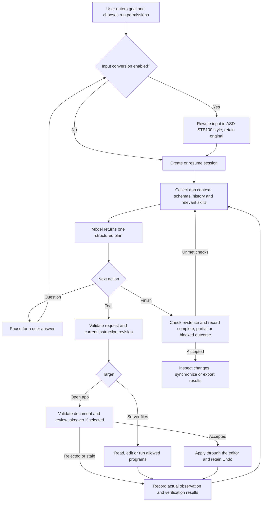

# How the coding agent updates your workspace

The coding agent turns a goal into a sequence of model requests and real tool calls. After each tool call, it observes the result and decides what to do next. The model proposes actions; the browser and server validate and execute them.

## Choose the destination first

There are three different places where content can live:

| Destination | What it contains | How the agent updates it |
| --- | --- | --- |
| Server workspace | Real files in the server's configured `--agent-workspace` directory | File tools and allowed commands change these files as the run proceeds. |
| Open app project | The document, deck, diagram or code project currently open in the browser | `read_current_project` and `apply_project` use the app's native validation, optional review and Undo. |
| Shared virtual disk | Files stored in this browser's shared IndexedDB storage | Explicit exports, imports or **Copy text to virtual disk** transfer content. A server file edit does not automatically update it. |

In codeiX, a folder opened through **Open workspace folder** is another connection: **Save to folder** explicitly writes the browser project back to that selected directory. It does not change the agent server's configured directory. See the [codeiX guide](../codeiX/README.md).

**Review before applying** controls takeovers into the open app project. It does not postpone server file writes or command side effects until the end of a run. Choosing **Apply without review** still keeps schema, reference, permission and stale-edit checks.

## The complete flow

### 1. Enter the goal and configure access

Open an app's **AI chat**, switch to **Coding agent**, and describe both the desired result and its destination. For example:

> Fix the addition function in calc.py in the server workspace. Read the current file first. Create a verification script, show that it fails before the fix, then run it successfully after the fix. Preserve unrelated files.

Expand **Agent runtime and workspace** to inspect the actual server directory and available executables. Under **Agent tools → Run setup**, configure file/script edits, commands, current-project takeover, app context, paging and acceptance checks.

Choose **Start new agent run**, then select **Review before applying** or **Apply without review** for app-project takeovers. The choice is retained for that run. A resumed session keeps its existing permissions and takeover policy.

### 2. Optionally simplify the submitted input

If **Convert input to ASD-STE100 style** is enabled, the configured relay/provider first rewrites the new input. Protected technical text must survive unchanged. The original remains authoritative and is retained alongside the rewrite.

This conversion happens once per submitted goal or follow-up, not once per planning step. A conversion failure or cancellation prevents the main submission. It is an AI-assisted style rewrite, not certified compliance. See [input conversion](../shared-ai/INPUT-STE.md).

### 3. Create the session and capture context

The local runtime creates a session ID, records the goal and permissions, and starts its audit history. A resume loads the existing session and records any new follow-up instead.

When enabled, app context includes the open project's native document, selected content, schema and tool-specific instructions. The browser archives full app context on the runtime so large fields can be retrieved later. Server files are a separate source: the model must inspect them through file tools rather than assume they match the browser project.

### 4. Prepare the model request

Before a planning turn, the agent synchronizes new user instructions and gathers relevant working memory, local skills, reusable workflows and shared catalog information. These are references for the task; they do not grant execution permissions or prove that a previous result is still valid.

The model receives the goal, current step/session identifiers, tool definitions, permissions, app schemas/context, task checklist, observations and verification state. Aggressive context compression is the default. Large history or source fields can become retrieval pointers; complete originals remain available through history/context tools. Request/result paging handles large transfers when needed.

The configured AI relay sends this structured request to the active model provider. The browser and local runtime perform tool execution; the model provider does not directly receive a terminal connection.

### 5. Receive and validate one plan

The response describes one of three next states:

| Response | What happens next |
| --- | --- |
| `act` | Execute one permitted tool action, then inspect its result. |
| `ask` | Pause for clarification. Enter an answer and use **Resume / send follow-up**. |
| `done` | Attempt to finish with a `complete`, `partial` or `blocked` outcome. |

The agent checks the response format, session/step IDs, tool name and applicable completion requirements. Malformed responses receive bounded correction feedback; rejected text does not execute as a tool call. Retained partial paging output is input for a fresh plan, not an executable incomplete action.

**Live trace** shows operation boundaries, public plans, tool calls and results. It does not expose private model reasoning. A checklist describes model-reported progress; actual command output and checks provide the execution evidence.

### 6. Execute the action against the selected destination

For **server workspace files**, the runtime validates the session, permissions, executable allowlist, paths and latest instruction revision. Existing file edits require a current content hash, preventing an old read from silently overwriting a changed file. File tools keep recovery copies and write changes immediately. Commands run on the server machine with that process's OS permissions; their arbitrary side effects are not automatically rolled back.

For the **open app project**, the agent first uses `read_current_project` to obtain a fresh snapshot. An `apply_project` action must identify that snapshot and supply the complete native document, or supported codeiX file changes. The browser:

1. Checks takeover permissions and the current instruction revision.
2. Rejects a stale snapshot or an editor that is busy with another operation.
3. Runs the app's validator against the proposed content.
4. Opens **Review project takeover** when the run requires review.
5. Rechecks instructions and the current document after review.
6. Applies through the editor's native adapter and retains an Undo reference.

**Apply reviewed changes** accepts that particular takeover. **Reject changes** leaves the app content unchanged. A run can propose more than one takeover, each subject to the selected policy. “Final takeover” is not a global transaction covering all earlier disk edits.

### 7. Record observations and verify

The runtime records the call ID, action, actual result and any checks. Command results include exit status and retained stdout/stderr; use output paging when the preview is incomplete. Tool success and a zero exit code do not establish that every requested behavior is correct.

The next model turn uses those observations to inspect failures, revise its approach, edit source or run another check. After an edit, the agent is expected to verify the changed result. Optional acceptance rules add machine-checked requirements for the run. Structural app validation confirms document shape and supported content, not functional correctness or factual accuracy.

If a response is lost, the client checks the recorded call ID before deciding what happened. It does not blindly repeat a write or command. Repeated unchanged actions are stopped for clarification.

### 8. Continue, pause or redirect

The cycle repeats until the agent asks a question, reports an outcome, encounters an unresolved failure, or you stop it. By default, it pauses every **500 planning steps** and waits for **Continue steps**. Set a shorter **Pause every** interval in Run setup if desired. Paging has its own separate pause settings.

**Pause after step** waits for the current step to settle. **Send instruction to active run** records a new follow-up; pending plans are rechecked before another action. New instructions cannot undo a tool that already started. **Stop agent** cancels the client loop and requests cancellation of the active command process group; completed changes remain.

Closing or switching the chat tab does not stop a run. Reloading the page is not an automatic continuation: load the saved session, inspect its state and resume explicitly.

When **Independent model review before completion** is enabled, a fresh reviewer context checks current changes and evidence before a complete outcome can be accepted. Rejection sends findings back to the planner; approval is tied to the reviewed state. This is separate from user review of browser-project takeovers.

### 9. Check the result and synchronize if needed

When the model requests completion, client/runtime checks compare its outcome with recorded tasks, verification and configured acceptance conditions. The result is recorded as complete, partial or blocked. Read the actual evidence rather than relying only on the completion summary.

Use these controls to find the result:

| Control | Purpose |
| --- | --- |
| **Browse intermediate files** | Separate read-only window for current server workspace files and session scripts; supports paging and optional refresh while running. |
| **Agent tools → Files & results** | Inspect changed files, recovery options and exports. |
| **Apply changed files to current project** in codeiX | Copy supported server-workspace file changes into the browser code project, following the run's review policy. |
| **Review changed files in codeiX** | Open a separate review of file synchronization into the browser project. |
| **Undo project edit** | Revert the last bridge takeover if newer app edits have not superseded it; otherwise use native editor history. |
| **Download run log** | Export the recorded session and protocol for inspection. |
| **Download result ZIP** | Package results, scripts, logs and evidence; read `RESULT.md` and manifest warnings. Downloading does not deploy or apply files. |

Server file changes already exist on disk; no final merge is needed to make those writes real. Browser-project changes remain in the app's storage until you explicitly export them, save them to the virtual disk, or use an app's local-folder save feature.

### 10. Keep or reuse the work

Sessions, context archives, working scripts, logs and file recovery data live under `<workspace>/.suite-agent/sessions/<session-id>/`. Working memory, local skills and reusable tool workflows use SQLite databases under `<workspace>/.suite-agent/`. The shared skill catalog has its own configured storage.

You can load a session later, inspect its evidence and send a follow-up. Versioned skills and workflows can be reused across sessions, but commands still require current permissions and applicable allowlists. A handoff or imported conversation is reference data; importing it does not execute its historical actions.

## Example: a failing addition function

This is an illustrative trace; the model can choose a different number or order of steps.

| Turn | Proposed action | Actual observation and next decision |
| --- | --- | --- |
| 1 | List files | Locate `calc.py`. |
| 2 | Read `calc.py` | Obtain its source and content hash; find `return a-b`. |
| 3 | Write a managed verification script | Create an assertion that `add(2, 3) == 5`. |
| 4 | Run the script | It exits nonzero. The incorrect result is observed before changing the source. |
| 5 | Replace `a-b` with `a+b` using the current hash | The server file changes immediately and a recovery copy is retained. |
| 6 | Run the script again | Exit 0 and actual output establish that this check passed against the changed file. |
| 7 | Inspect workspace changes | Confirm the intended source edit and identify any other changes. |
| 8 | Report the outcome | Summarize the edit and observed verification; disclose untested requirements or remaining blockers. |

At turn 5, the server file is already updated. Copying it into the codeiX browser project is a separate synchronization step. For a native app document, the corresponding path is `read_current_project` → validated/reviewed `apply_project`, rather than editing that app's source files on disk.

For advanced setup and current limits, see [coding-agent techniques](TECHNIQUES.md), including semantic navigation/memory, dependency plans, independent completion review and live evaluations.

## Implementation map

For readers who want to follow the code:

| Stage | Source |
| --- | --- |
| Run controls, relay calls, session synchronization, trace and review UI | [ui.js](ui.js) |
| Optional controlled-English rewrite | [input-ste.js](../shared-ai/input-ste.js) |
| Iteration, plan validation, questions and completion guards | [loop.js](loop.js), [spec.js](spec.js) |
| Compression and archived context recovery | [context.js](context.js), [agent_context.py](../server/agent_context.py) |
| Local files, commands, audit events and result packaging | [agent_runtime.py](../server/agent_runtime.py) |
| Native app snapshot, validated takeover and Undo bridge | [project.js](project.js) |
| Executable failing-check → source-fix → successful-check example | [browser-test.cjs](browser-test.cjs) |

See the [coding-agent reference](README.md) for individual tools, acceptance checks, memory, skills, workflows, paging and recovery details.

Invalid planning replies never execute tools. After bounded correction attempts, the agent offers saved-state/direct-mode retries, follow-up guidance and response diagnostics. See [response recovery](README.md#recover-rejected-planning-responses) for the available options and identifier rules.
